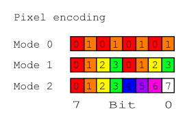

# 03. Screen

> **Explanation of revisions.** The document describes two platforms: the classic Amstrad CPC and its clone Aleste 520EX. Where behavior matches, this is not stated. Where there are differences, notes **[CPC]** and **[Aleste]** are added. All critical errors of the original version have been fixed; disputed points (video pipeline latency) have been rewritten with an explicit caveat about the status of the information.

---

The screen is the most noticeable part of any program, and in the CPC it is associated with the most unpleasant surprises. The main one is that video memory is not addressed the way you expect. Not linearly. Pixel by pixel, row by row — that won't work.

In this section we'll figure out why that is, and how to live with it. And also — screen modes, palette, CRTC, memory contention, video pipeline latency (with caveats), scrolling, and how to output the first pixel.

---

## Video chip: MC6845

The CPC and the Aleste use the MC6845 chip — a CRT controller. It manages the raster and generates video memory addresses. The programmer can configure it through registers, but for most tasks this is not necessary: the BIOS has already set the standard values.

CRTC ports:

| Port    | What it does    | R/W |
|---------|-----------------|-----|
| `#BCxx` | Register number | W   |
| `#BDxx` | Data (write)    | W   |
| `#BExx` | Status          | R   |
| `#BFxx` | Data (read)     | R   |

Here `xx` is any byte: on the CPC only the high address bits are decoded, so `#BC00`, `#BC28`, `#BCFF` are the same register-select port. In the examples below, `#BC00` and `#BD00` are used for definiteness.

To write a value to a CRTC register, first write the register number to `#BC00`, then the value to `#BD00`:

```asm
LD A, 1            ; register 1 (horizontal displayed width)
OUT (#BC00), A
LD A, 40           ; 40 characters per row
OUT (#BD00), A
```

To read — same thing, but you read data from `#BF00`. However, **not all registers are readable** on all CRTC types. The most compatible approach is to assume that only R12–R17 can be read (and even then with caveats for different types). In practice, CRTC registers are almost always write-only.

Example in BASIC for experiments without assembly:

```basic
OUT &BC00, 1: OUT &BD00, 42
```

This sets register 1 to the value 42.

---

## CRTC registers

The CRTC has 18 registers numbered 0–17 (register number 18 and above does not exist; on some clones reading from them returns 0 or 0xFF, but you can't rely on this). Here they are with default values for the standard CPC screen:

The CRTC configuration for various screen modes is given in the table below. There are two main modes: the first is the standard CPC 16KB screen buffer, and the second is the Aleste 32KB extension.

| Register | 16KB | 32KB | Read   | Default                     |
|----------|------|------|--------|-----------------------------|
| 0        | 3F   | 6B   | -/W    | Total horizontal (clocks)   |
| 1        | 28   | 50   | -/W    | Horizontal displayed (chars)|
| 2        | 2E   | 52   | -/W    | Horizontal sync position    |
| 3        | 8E   | 8E   | -/W    | HSync duration              |
| 4        | 1F   | 1F   | -/W    | Total vertical (rows)       |
| 5        | 06   | 06   | -/W    | Vertical adjustment         |
| 6        | 19   | 19   | -/W    | Vertical displayed (rows)   |
| 7        | 1B   | 1B   | -/W    | Vertical sync position      |
| 8        | 00   | 00   | -/W    | Interlace/skew              |
| 9        | 07   | 07   | -/W    | Rows per character          |
| 10       | 00   | 00   | -/W    | Cursor start (row)          |
| 11       | 00   | 00   | -/W    | Cursor end (row)            |
| 12       | 30   | 30   | R/W    | Screen start high byte      |
| 13       | 00   | 00   | R/W    | Screen start low byte       |
| 14       | 00   | 00   | R/W    | Cursor position high byte   |
| 15       | 00   | 00   | R/W    | Cursor position low byte    |
| 16       | ──   | ──   | R/-    | Light pen position          |
| 17       | ──   | ──   | R/-    | high and low bytes          |

**Critically important for scrolling and double buffering:** R12 is the **high** byte of the screen start address, R13 is the **low** byte. In the original version of the document these registers were swapped, which made the code examples non-working. Remember: **12 = High, 13 = Low**.

With these values the screen is 40 characters wide and 25 high, giving 1000 character positions. Each character in mode 1 takes 2 bytes, so the useful screen data is 2000 bytes. However, **addressing is not linear**, and that's covered below.

### How much memory the screen actually occupies

The CRTC generates an address for each character row (one of 25) and each raster line within it (0–7). Within one character row the address increases by **2048 bytes (0x800)** when moving to the next raster line. This means that each of the 8 raster lines of one character row lies in its own 2-kilobyte block.

For 40 characters at 2 bytes each (mode 1), one raster line occupies **80 bytes**. In a 2048-byte block, 80 are usefully used, the remaining 1968 bytes are "invisible" memory. The whole screen (25 character rows × 8 raster lines) accounts for 25 × 8 × 80 = 16,000 bytes of useful data, spread across 8 blocks of 2048 bytes each (16,384 bytes total). The 384-byte difference is that very "invisible" memory that can "leak out" during hardware scrolling. (In the original version of the document this calculation was mixed up: 48 bytes is the difference at one level, not per row.)

---

## Screen modes

### [CPC] Three classic modes (16 KB video memory)

The CPC has three graphics modes, selected through the Gate Array. The mode-select register is RMR, accessible at address `#7Fxx` (any address in the range `#7F00–#7FFF`; to write to RMR, bits 7,6 of the data must be `10`).

| Mode | Resolution      | Colors | Memory | Bytes per row | Characters per row |
|------|-----------------|--------|--------|---------------|--------------------|
| 0    | 160×200         | 16     | 16 KB  | 80            | 20                 |
| 1    | 320×200         | 4      | 16 KB  | 80            | 40                 |
| 2    | 640×200         | 2      | 16 KB  | 80            | 80                 |
| 3    | not used        | —      | —      | —             | —                  |

RMR format:

| Bits | Value | Function                                                      |
|------|-------|---------------------------------------------------------------|
| 7,6  | 1,0   | RMR register select constant                                  |
| 5    | —     | CAPS LED                                                      |
| 4    | x     | RUS LED                                                       |
| 3    | x     | 1 = Upper ROM area disable, 0 = Upper ROM area enable         |
| 2    | x     | 1 = Lower ROM area disable, 0 = Lower ROM area enable         |
| 1,0  | x     | Graphics Mode selection (00 = mode 0, 01 = mode 1, 10 = mode 2) |

### [Aleste] Additional HIGHX bit (32 KB video memory)

The Aleste has a **HIGHX** bit in the `Ext Port` register at address `#FABF` (bit 1). When HIGHX = 0, the Aleste works like a standard CPC (16 KB buffer, modes 0/1/2). When HIGHX = 1, the doubled video buffer (32 KB) is enabled, and the modes change their characteristics. At the same time the CPU clock is reduced (from ~4 MHz, derived from 16 MHz, to ~3.2 MHz, derived from 13 MHz). This is done so that the pixel aspect ratio approaches that of the MSX — specifically for emulating MSX games on the Aleste.

**Important:** in HIGHX mode, "mode 0" and "mode 1" mean **not the same thing** as in normal CPC. This is confusing, so remember:

| HIGHX | Mode number (RMR bits 1,0) | Resolution | Colors | Memory | Bytes per row |
|-------|----------------------------|------------|--------|--------|---------------|
| 1     | 00 ("mode 0")              | 640×200    | 4      | 32 KB  | 160           |
| 1     | 01 ("mode 1")              | 320×200    | 16     | 32 KB  | 160           |

That is, with HIGHX=1 "mode 0" is effectively a doubled classic mode 1 (2 bits per pixel, 4 colors), and "mode 1" is a doubled classic mode 0 (4 bits per pixel, 16 colors). The number of bytes per row doubles (160 instead of 80) because each row now occupies two 16-kilobyte banks: even rows in one, odd rows in the other.

### How to select a mode (assembly example)

```asm
; Note: bits 7,6 = 10 mean write to RMR
; Example for CPC mode 1 (320x200, 4 colors)
; ROMs left enabled (bits 3,2 = 0)
LD A, %10000001    ; bits 7,6 = 10 → RMR; bits 1,0 = 01 → mode 1
OUT (#7F00), A
```

For the Aleste with HIGHX you must first set bit 1 in `#FABF`, then select the mode via RMR. The details of configuring Ext Port are beyond the scope of this section; the main thing is to remember that the mode numbering "shifts".

---

## Pixel color format

The pixel format determines how many pixels are in a byte and how many bits per pixel.

### [CPC] 16 KB modes

- **Mode 2:** each byte contains 8 pixels at 1 bit each (2 colors).
- **Mode 1:** each byte contains 4 pixels at 2 bits each (4 colors).
- **Mode 0:** each byte contains 2 pixels at 4 bits each (16 colors).

Byte structure (bits 7…0):

```txt
+-----------+---------------------------------------+-------------------------------+
| Mode      | Byte structure                        | On-screen mapping             |
+-----------+----+----+----+----+----+----+----+----+-------------------------------+
| %00 (0)   | A0 | B0 | A2 | B2 | A1 | B1 | A3 | B3 | A (4 bits) | B (4 bits)      |
| %01 (1)   | A0 | B0 | C0 | D0 | A1 | B1 | C1 | D1 | A | B | C | D (2 bits each) |
| %10 (2)   | A  | B  | C  | D  | E  | F  | G  | H  | A|B|C|D|E|F|G|H (1 bit each) |
+-----------+----+----+----+----+----+----+----+----+-------------------------------+
```

Note the bit permutation in modes 0 and 1: the pixel bits are "spread" across the byte not consecutively. This is a legacy of the Gate Array architecture, and it is precisely why special macros exist for assembling a byte from colors.

### [Aleste] 32 KB modes (HIGHX)

In HIGHX modes the format is the same as the corresponding "doubled" classic modes:
- HIGHX "mode 0" (640×200, 4 colors): 2 bits per pixel, 4 pixels per byte (like classic mode 1).
- HIGHX "mode 1" (320×200, 16 colors): 4 bits per pixel, 2 pixels per byte (like classic mode 0).

The macros below are given for the **classic 16 KB modes**. For HIGHX use the macros of the corresponding classic "twin" mode.

### Pixel/ink conversion macros (16 KB modes)

```c
// Mode 1 (4 colors, 2 bits per pixel)
#define MODE_1_P0(c) (((c & 2) >> 1) << 3) | ((c & 1) << 7)
#define MODE_1_P1(c) (((c & 2) >> 1) << 2) | ((c & 1) << 6)
#define MODE_1_P2(c) (((c & 2) >> 1) << 1) | ((c & 1) << 5)
#define MODE_1_P3(c) (((c & 2) >> 1) << 0) | ((c & 1) << 4)

// Mode 0 (16 colors, 4 bits per pixel)
#define MODE_0_P0(c) ((c & 8) >> 2) | ((c & 4) << 3) | ((c & 2) << 2) | ((c & 1) << 7)
#define MODE_0_P1(c) ((c & 8) >> 3) | ((c & 4) << 2) | ((c & 2) << 1) | ((c & 1) << 6)
```

To get a full byte for two pixels in mode 0 or four in mode 1, the corresponding macros are combined with `|`.

---

The image below shows how to encode two, 4, or 16 colors in different modes. For example, in mode 0, on the left picture we see two large pixels: red and orange. On the right picture is how the bits of these pixels are arranged in the byte. A similar situation applies to the other modes.

<table><tr><td>


</td><td>



</td></tr></table>

---

## Color palette

The palette interpretation mode is switched together with **MAPMOD** (in Aleste terminology; on the classic CPC there is no such switch — there it is always "CPC mode").

- **MAPMOD = 0 (CPC mode):** the value written to the palette is interpreted through a fixed table of 5-bit codes, giving **27 unique colors** (out of 32 possible codes; some codes duplicate each other).
- **MAPMOD = 1 (Aleste mode):** the value is interpreted directly as R,G,B with two bits per channel, giving **64 colors**.

In practice this means: **the same byte will give a different color in different modes**. If you switch MAPMOD, be prepared to reconfigure the palette.

Another nuance: in CPC mode the Aleste uses only the "dark" brightness levels (0%, 33%, 66%), because the CPC palette is designed for three levels. Because of this, the 64-color mode appears brighter. This is normal, just keep it in mind when switching.

### [CPC] Palette: 27 colors

A 5-bit code gives **32 combinations (0–31)**, but there are **27 unique colors** among them. Some codes are duplicates (for example, code 1 repeats white code 0, code 8 repeats purple code 5, etc.). In the table below duplicates are marked "(dup)".

| Color number | Color name                   | R % | G % | B % | Image                                                     |
|--------------|------------------------------|-----|-----|-----|-----------------------------------------------------------|
| 0            | White                        | 50  | 50  | 50  |  |
| 1            | White (note 1)               | 50  | 50  | 50  |  |
| 2            | Sea Green                    | 0   | 100 | 50  |  |
| 3            | Pastel Yellow                | 50  | 50  | 0   |  |
| 4            | Blue                         | 0   | 0   | 50  |  |
| 5            | Purple                       | 100 | 0   | 50  |  |
| 6            | Cyan                         | 0   | 50  | 50  |  |
| 7            | Pink                         | 100 | 50  | 50  |  |
| 8            | Purple (note 1)              | 100 | 0   | 50  |  |
| 9            | Pastel Yellow (note 1)       | 50  | 50  | 0   |  |
| 10           | Bright Yellow                | 100 | 100 | 0   |  |
| 11           | Bright White                 | 100 | 100 | 100 |  |
| 12           | Bright Red                   | 100 | 0   | 0   |  |
| 13           | Bright Magenta               | 100 | 0   | 100 |  |
| 14           | Orange                       | 100 | 50  | 0   |  |
| 15           | Pastel Magenta               | 100 | 50  | 100 |  |
| 16           | Blue (note 1)                | 0   | 0   | 50  |  |
| 17           | Sea Green (note 1)           | 0   | 100 | 50  |  |
| 18           | Bright Green                 | 0   | 100 | 0   |  |
| 19           | Bright Cyan                  | 0   | 100 | 100 |  |
| 20           | Black                        | 0   | 0   | 0   |  |
| 21           | Bright Blue                  | 0   | 0   | 100 |  |
| 22           | Green                        | 0   | 50  | 0   |  |
| 23           | Sky Blue                     | 0   | 50  | 100 |  |
| 24           | Magenta                      | 50  | 0   | 50  |  |
| 25           | Pastel Green                 | 50  | 100 | 0   |  |
| 26           | Lime                         | 50  | 100 | 0   |  |
| 27           | Pastel Cyan                  | 50  | 100 | 100 |  |
| 28           | Red                          | 50  | 0   | 0   |  |
| 29           | Mauve                        | 50  | 0   | 100 |  |
| 30           | Yellow                       | 50  | 50  | 0   |  |
| 31           | Pastel Blue                  | 50  | 50  | 100 |  |

**How to read the table:** codes 0–15 are pixel colors (they can be assigned to palette indices). Code 16 is the border color. Codes 17–31 give the same border (hardware-wise the border uses only the low 4 bits of the index, but code 16 is the canonical way to set the border). When assigning palette colors for pixels, indices 0–15 are used; code 16 and above are not used for pixels.

### [Aleste] Palette: 64 colors

When MAPMOD = 1, each color is encoded in six bits:

```txt
bit 5,4 — red
bit 3,2 — green
bit 1,0 — blue
```

Each component takes values 0–3 (0%, 33%, 66%, 100%). This gives 4 × 4 × 4 = 64 colors.

### How to write a color to the palette

The palette is controlled through the Gate Array, registers 0 and 1:

- **Register 0** — palette index select (which of the 16 colors you are changing).
- **Register 1** — color data.

```asm
; Select index 4 (the fifth palette color)
LD A, %00000000    ; bits 7,6 = 00 → register 0
OUT (#7F00), A
LD A, 4            ; index 4
OUT (#7F00), A

; Write color: R=2, G=0, B=2 → purple
LD A, %01000000    ; bits 7,6 = 01 → register 1
OUT (#7F00), A
LD A, %00100010    ; %RRGGBB = %00 10 00 10 = R=2, G=0, B=2
OUT (#7F00), A
```

Indices 0–15 are pixel colors. Index 16 (0x10) is the border. Indices 17–31 give the same border.

---

## Video memory addressing: the most important part

And now — the thing that makes many people give up on CPC programming. Video memory is addressed **non-linearly**. Rows do not go consecutively.

The reason is historical: the MC6845 was designed for text terminals, and the addressing is optimized for character rows, not for a linear raster.

In an ordinary computer the pixel address is computed like this: `base + y * width + x`. In the CPC it is different. Rows are grouped into blocks of 8 (by the number of raster lines in a character), and within a block the rows go with a step of 0x800 (2048 bytes). Between blocks the step equals the length of one raster line in bytes (for 16 KB modes this is 80 bytes).

### [CPC] Map for the 16 KB buffer

```txt
  ┌───────┬───────┬───────┬───────┬─ ─ ─ ─ ─ ─┬───────┬───────┐
0 │A+    0│A+    1│A+    2│A+    3│           │A+   78│A+   79│
  ├───────┼───────┼───────┼───────┼─ ─ ─ ─ ─ ─┼───────┼───────┤
1 │A+ 2048│A+ 2049│A+ 2050│A+ 2051│           │A+ 2126│A+ 2127│
  ├───────┼───────┼───────┼───────┼─ ─ ─ ─ ─ ─┼───────┼───────┤
2 │A+ 4096│A+ 4097│A+ 4098│A+ 4099│           │A+ 4174│A+ 4175│
  ├───────┼───────┼───────┼───────┼─ ─ ─ ─ ─ ─┼───────┼───────┤
3 │A+ 6144│A+ 6145│A+ 6146│A+ 6147│           │A+ 6222│A+ 6223│
  ├───────┼───────┼───────┼───────┼─ ─ ─ ─ ─ ─┼───────┼───────┤
4 │A+ 8192│A+ 8193│A+ 8194│A+ 8195│           │A+ 8270│A+ 8271│
  ├───────┼───────┼───────┼───────┼─ ─ ─ ─ ─ ─┼───────┼───────┤
5 │A+10240│A+10241│A+10242│A+10243│           │A+10318│A+10319│
  ├───────┼───────┼───────┼───────┼─ ─ ─ ─ ─ ─┼───────┼───────┤
6 │A+12288│A+12289│A+12290│A+12291│           │A+12366│A+12367│
  ├───────┼───────┼───────┼───────┼─ ─ ─ ─ ─ ─┼───────┼───────┤
7 │A+14336│A+14337│A+14338│A+14339│           │A+14414│A+14415│
  ├───────┼───────┼───────┼───────┼─ ─ ─ ─ ─ ─┼───────┼───────┤
8 │A+   80│A+   81│A+   82│A+   83│           │A+  158│A+  159│
  ├───────┼───────┼───────┼───────┼─ ─ ─ ─ ─ ─┼───────┼───────┤
  .       .       .       .       .           .       .       .
  .       .       .       .       .           .       .       .
  ├───────┼───────┼───────┼───────┼─ ─ ─ ─ ─ ─┼───────┼───────┤
6 │A+  160│A+  161│A+  162│A+  163│           │A+  238│A+  239│

  ├───────┼───────┼───────┼───────┼─ ─ ─ ─ ─ ─┼───────┼───────┤
  .       .       .       .       .           .       .       .
  .       .       .       .       .           .       .       .
  ├───────┼───────┼───────┼───────┼─ ─ ─ ─ ─ ─┼───────┼───────┤
9 │A+15920│A+15921│A+15922│A+15923│           │A+15998│A+15999│
  └───────┴───────┴───────┴───────┴───────────┴───────┴───────┘
  Where A is the screen start address.
```

The first eight rows go with a step of 2 KB, and the ninth returns almost to the beginning — but with an offset of 80 bytes (the length of one raster line). This is the "block" addressing: 8 raster lines of one character occupy 8 blocks of 2048 bytes, and the next character starts at offset +80 within the same blocks.

### Why it is so: MA and RA

The CRTC has two counters: **MA** (Master Address, 14 bits) and **RA** (Raster Address, 5 bits).

- **MA** — the video memory address for the current character position.
- **RA** — the raster line number within the character (0–7).

When moving to the next raster line within a character (RA is incremented), the address shifts by **0x800** (2048). This gives the 2 KB step between lines 0–7. After RA=7 the RA counter resets, and MA increases by the length of one raster line (for mode 1 — by 80). This gives the transition from line 7 to line 8: the address shifts by 80 bytes.

The formation of the physical address from MA and RA in the CPC looks like this (for 16 KB mode):

| Address bit | Source   |
|-------------|----------|
| A15         | MA13     |
| A14         | MA12     |
| A13         | RA2      |
| A12         | RA1      |
| A11         | RA0      |
| A10–A0      | MA9–MA0  |

MA11 and MA10 are not used in 16 KB mode (grounded). MA12 and MA13 select the video bank (0x0000, 0x4000, 0x8000, or 0xC000).

### Address formula for 16 KB modes

```c++
// For mode 0 (160×200, 16 colors, 16 KB):
address = base + (y & 7) * 2048 + (y >> 3) * 80 + (x >> 1)

// For mode 1 (320×200, 4 colors, 16 KB):
address = base + (y & 7) * 2048 + (y >> 3) * 80 + (x >> 2)

// For mode 2 (640×200, 2 colors, 16 KB):
address = base + (y & 7) * 2048 + (y >> 3) * 80 + (x >> 3)
```

Where:
- `base` — start of video memory (usually 0xC000).
- `y` — raster line number (0–199).
- `x` — pixel number in the row (0–159 / 0–319 / 0–639).
- `&` — bitwise AND.
- `>>` — right shift.
- **`x >> 1` for mode 0** (2 pixels per byte), **`x >> 2` for mode 1** (4 pixels per byte), **`x >> 3` for mode 2** (8 pixels per byte). In the original version of the document the comment "divide by 4" erroneously referred to all modes; this is true only for mode 1.

### [Aleste] Address formula for 32 KB modes (HIGHX)

In HIGHX the raster line length doubles (160 bytes instead of 80), and even and odd rows lie in different 16-kilobyte banks. The map looks like this:

```txt
  ┌───────┬───────┬───────┬───────┬─ ─ ─ ─ ─ ─┬───────┬───────┐
0 │A+    0│A+    1│A+    2│A+    3│           │A+  158│A+  159│
  ├───────┼───────┼───────┼───────┼─ ─ ─ ─ ─ ─┼───────┼───────┤
1 │A+16384│A+16385│A+16386│A+16387│           │A+16462│A+16463│
  ├───────┼───────┼───────┼───────┼─ ─ ─ ─ ─ ─┼───────┼───────┤
2 │A+ 4096│A+ 4097│A+ 4098│A+ 4099│           │A+ 4174│A+ 4175│
  ├───────┼───────┼───────┼───────┼─ ─ ─ ─ ─ ─┼───────┼───────┤
3 │A+20480│A+20481│A+20482│A+20482│           │A+20638│A+20639│
  ├───────┼───────┼───────┼───────┼─ ─ ─ ─ ─ ─┼───────┼───────┤
4 │A+ 8192│A+ 8193│A+ 8194│A+ 8195│           │A+ 8270│A+ 8271│
  ├───────┼───────┼───────┼───────┼─ ─ ─ ─ ─ ─┼───────┼───────┤
5 │A+24576│A+24577│A+24578│A+24579│           │A+24734│A+24735│
  ├───────┼───────┼───────┼───────┼─ ─ ─ ─ ─ ─┼───────┼───────┤
6 │A+12288│A+12289│A+12290│A+12291│           │A+12366│A+12367│
  ├───────┼───────┼───────┼───────┼─ ─ ─ ─ ─ ─┼───────┼───────┤
7 │A+28672│A+28673│A+28674│A+28675│           │A+28830│A+28831│
  ├───────┼───────┼───────┼───────┼─ ─ ─ ─ ─ ─┼───────┼───────┤
8 │A+  160│A+  161│A+  162│A+  163│           │A+  318│A+  319│
  ├───────┼───────┼───────┼───────┼─ ─ ─ ─ ─ ─┼───────┼───────┤
  .       .       .       .       .           .       .       .
  .       .       .       .       .           .       .       .
  ├───────┼───────┼───────┼───────┼─ ─ ─ ─ ─ ─┼───────┼───────┤
6 │A+  320│A+  321│A+  322│A+  323│           │A+  478│A+  479│
  ├───────┼───────┼───────┼───────┼─ ─ ─ ─ ─ ─┼───────┼───────┤
  .       .       .       .       .           .       .       .
  .       .       .       .       .           .       .       .
  ├───────┼───────┼───────┼───────┼─ ─ ─ ─ ─ ─┼───────┼───────┤
9 │A+32224│A+32225│A+32226│A+32227│           │A+32382│A+32383│
  └───────┴───────┴───────┴───────┴───────────┴───────┴───────┘
  Where A is the screen start address.
```

**Corrected formulas** (in the original version the formula for odd rows did not match the map):

```c++
// Even rows (y & 1 == 0):
address = base + (y & 7) * 4096 + (y >> 3) * 160 + (x >> shift)

// Odd rows (y & 1 == 1):
address = base + (y & 7) * 4096 + (y >> 3) * 160 + (x >> shift) + 16384
```

Where `shift` depends on the HIGHX mode:
- HIGHX "mode 0" (640×200, 4 colors, 2 bits/pixel): `shift = 2`
- HIGHX "mode 1" (320×200, 16 colors, 4 bits/pixel): `shift = 1`

**Check for y=1 (odd):** `(1 & 7) * 4096 = 4096`, `(1 >> 3) * 160 = 0`, `+ 16384` = **20480**. But in the map row 1 = A + 16384. Discrepancy? No: the map shows the **offset relative to A for the start of the row**, while the formula gives the address **within the bank taking (y&7) into account**. For y=1 the "pure" address within the odd bank is `(1&7)*4096 = 4096`, but row 1 itself lies in the bank at +16384. In the map, for simplicity, `A + 16384` is shown (without the internal offset 4096), because row 1 is the **first** odd row, and its internal offset within the odd bank is 0, not 4096. This "map vs formula" discrepancy is because `(y&7)` for y=1 gives 1, but within the odd bank the raster row numbering starts over. **Practical conclusion:** to compute the address use the formula with `(y & 7)`, but remember that for odd rows the RA count within the bank starts from 0 for the first odd row (y=1), from 1 for the second (y=3), and so on. If this seems complicated — **build a table of row addresses in advance** (see below); this is a standard technique and saves you from all these subtleties.

---

### How to compute the address in assembly: the right approach

Manual multiplication by 2048 and 80 in every function is a path to errors. **The standard technique in CPC programs is a table of row start addresses.** 200 rows × 2 bytes = 400 bytes. Compute it once (or generate it) — then take the ready value by index y.

If for some reason a table doesn't suit you, here is a **corrected** version of the function for mode 1 (16 KB), where multiplication by 80 is implemented explicitly:

```asm
; Input: B = y (0-199), C = x (0-319)
; Output: HL = byte address in video memory
; Video memory base = 0xC000

GetPixelAddr:
    ; HL = (y & 7) * 2048
    LD A, B
    AND 7
    LD L, A
    LD H, 0
    ADD HL, HL      ; *2
    ADD HL, HL      ; *4
    ADD HL, HL      ; *8
    ADD HL, HL      ; *16
    ADD HL, HL      ; *32
    ADD HL, HL      ; *64
    ADD HL, HL      ; *128
    ADD HL, HL      ; *256
    ADD HL, HL      ; *512
    ADD HL, HL      ; *1024
    ADD HL, HL      ; *2048

    ; DE = (y >> 3) * 80
    LD A, B
    SRL A
    SRL A
    SRL A           ; A = y >> 3
    LD E, A
    LD D, 0
    ; E * 80 = E * 64 + E * 16
    LD L, E         ; save E in L (temporarily)
    LD H, 0
    ADD HL, HL      ; *2
    ADD HL, HL      ; *4
    ADD HL, HL      ; *8
    ADD HL, HL      ; *16
    LD D, H
    LD E, L         ; DE = E*16
    ; now we need E*64: shift DE two more times (16*4 = 64)
    SLA E
    RL D
    SLA E
    RL D            ; DE = E*64
    ; add: DE = E*64 + E*16
    ; but E*16 was lost in HL? No — save it carefully.
    ; (A full implementation requires a couple of register pairs;
    ; it's easier to use a multiplication table for 80.)
```

As you can see, even a "simple" function becomes complicated. **A table of row addresses is the only reasonable way.** Here is how it can be built (pseudocode):

```c
// Table of 200 words (addresses)
uint16_t row_addr[200];
for (int y = 0; y < 200; y++) {
    row_addr[y] = 0xC000 + (y & 7) * 2048 + (y >> 3) * 80;
}
```

For HIGHX modes the formula is different, but the principle is the same.

---

## How to write a pixel

Knowing the byte address and the pixel position within the byte, you can write a color. In mode 1 (4 colors) a byte holds four pixels, two bits each:

```txt
bits 7,6 — first pixel
bits 5,4 — second pixel
bits 3,2 — third pixel
bits 1,0 — fourth pixel
```

To write a color to a specific pixel:

1. Read the byte.
2. Clear the two bits corresponding to the pixel.
3. Write the new value there.
4. Write the byte back.

Example for pixel number `n` in the byte (0–3), mode 1:

```asm
; Input: HL = byte address, A = color (0-3), B = n (0-3)
; Using mask and shift tables for simplicity

    ; shift = 6 - 2*n
    LD C, A         ; save the color
    LD A, 6
    SUB B
    SUB B           ; A = 6 - 2n (shift)

    ; load the byte
    LD D, (HL)      ; D = old byte

    ; mask = 3 << shift
    LD E, %00000011
    ; (shift E left A times — in real code via a table or loop)

    ; clear the bits: D = D AND NOT(mask)
    ; write the color: C << shift
    ; combine: D = D OR (C << shift)
    ; write back: LD (HL), D
```

It's tedious, but one-off. Usually programs have a ready "put pixel" routine, and everyone uses it. For modes 0 and 2 the logic is analogous; only the number of bits per pixel and the position change.

---

## Memory contention

A separate topic worth knowing about. The Gate Array and the Z80 share the same memory bus. When both want to access memory at the same time, a conflict arises, and the Gate Array slows the CPU via the WAIT signal.

**[CPC]** The Gate Array runs at 16 MHz, divides to 4 MHz for the Z80 and 1 MHz for the CRTC. The Gate Array READY signal is connected to the Z80 WAIT input. The processor and the Gate Array access memory in turn; in the typical case the Z80 gets memory access in one of four clock cycles, and video in the others. Practical consequence: Z80 machine cycles that are not multiples of four clock cycles are "stretched" to four, and the effective CPU speed is about 3.3 MHz instead of the nominal 4. For precise effects (raster, split) this must be taken into account.

**[Aleste]** In HIGHX mode the CPU clock is reduced (to ~3.2 MHz), and contention timings may differ from the classic CPC. If you do precise effects on the Aleste, verify them on real hardware or in an emulator with Aleste support (Caprice32-Aleste, MESS).

---

## Character output

To output text, a font is used — a table of 8 bytes per character (8 rows of 8 pixels). Characters are 8×8, with 40 characters per row (mode 1) or 80 (mode 0).

Outputting a character means calling the pixel-write routine 8 times, one font row at a time. Slow but simple. For fast output, tricks with masks and shifts are used, but that's optimization.

The standard font is in ROM. The BIOS also provides ready-made character output functions (e.g. `TXT_OUTPUT`) if you don't want to write your own.

**Warning:** the example from the original version of the document (`addr = &C000 + y * 80 + x`) **does not work** due to the non-linear addressing. Even for y=1 it gives the wrong address. If you want to draw an 8×8 character in mode 2, use the correct formula:

```basic
10 MODE 2
20 DATA &18,&3c,&7e,&ff,&ff,&7e,&3c,&18
30 INPUT "x pos (0-639)";x : INPUT "y pos (0-199)";y
40 REM address for mode 2: (y AND 7)*2048 + (y\8)*80 + (x\8)
50 addr = &C000 + (y AND 7)*2048 + (y\8)*80 + (x\8)
60 FOR y0 = 0 TO 7
70 READ p
80 POKE addr, p
90 addr = addr + &800    : REM next raster line of the character
100 NEXT
110 END
```

Note: within a character (8 raster lines) the address increases by 0x800, not by 80. This corresponds to the block structure.

---

## Hardware scrolling

Scrolling can be done in hardware — via CRTC registers **R12 (High)** and **R13 (Low)**, which set the video memory start address. Change them — the screen shifts.

**Once again, so as not to forget: R12 = high byte, R13 = low byte.** In the original version of the document there was an error here.

BASIC example (set the screen start to 0x4000):

```basic
10 REM set R12 = 0x40, R13 = 0x00
20 OUT &BC00, 12: OUT &BD00, &40
30 OUT &BC00, 13: OUT &BD00, &00
```

Incrementing the address by 1 shifts the screen by 1 byte (in mode 1 — by 2 pixels, in mode 2 — by 4 pixels, in mode 0 — by 1 pixel). The screen "wraps around", so you need to draw what appears on the other side. This is coarse (character/byte) scrolling; smooth pixel scrolling requires more complex tricks (on the Aleste, for example, there are additional registers for pixel shifting).

---

## Fullscreen / Overscan

It is possible to enable a mode where the screen covers not 16 KB but 32 KB (two video banks). To do this you need to set MA10 and MA11 to 1, then MA12 and MA13 will overflow and addresses will come from the range 0x0000–0x7FFF or 0x8000–0xFFFF. Technically this works because MA10/MA11 do not participate directly in address formation, but affect the carry into MA12/MA13 on increment.

Example of CRTC setup for fullscreen (values are approximate, depend on the monitor and CRTC type):

```basic
OUT &BC00, 1: OUT &BD00, 50   ' Horizontal displayed
OUT &BC00, 2: OUT &BD00, 51   ' Horizontal sync position
OUT &BC00, 6: OUT &BD00, 33   ' Vertical displayed
OUT &BC00, 7: OUT &BD00, 35   ' Vertical sync position
```

**Warning:** incorrect setting of R2 (HSync) or R7 (VSync) can throw the monitor out of sync. Grimware explicitly recommends not programming breaks in HSync/VSync timings and maintaining HSync every 64 µs with a duration of at least 8 µs, VSync every 19968 µs. If unsure — don't touch it.

To access the full 32 KB, the video bank must be correctly mapped (R12 to the appropriate value).

---

## Double buffering

If a program draws something dynamic (a game, a demo), flicker will be noticeable if you draw directly into the visible video memory. The solution is double buffering.

The idea: there are two screens. One is visible, the other is being drawn. When drawing is finished, the screens are swapped. Then there is no flicker — the viewer sees the finished picture.

In the CPC/Aleste this is done by changing the video memory base address in the CRTC (R12 and R13) or through the mapper — if the screen is in different memory banks.

The CRTC method is simpler: registers 12 (High) and 13 (Low) set the screen start address. Change them — and what the picture is read from changes.

**Corrected example** (set the screen start to 0x4000):

```asm
; R12 = High = 0x40
LD A, 12
OUT (#BC00), A
LD A, 0x40
OUT (#BD00), A

; R13 = Low = 0x00
LD A, 13
OUT (#BC00), A
LD A, 0x00
OUT (#BD00), A
```

In the original version of the document the values were swapped (0x00 was written to R12, 0x40 to R13), which would send the screen to the wrong place. **High = 12, Low = 13.**

The mapper method is more powerful (you can switch whole banks), but it requires both screens to lie in different banks and to be correctly mapped.

**Limitation:** R12/R13 set the address only with an accuracy of 2 bytes within the first 2048 bytes of each 16-kilobyte bank. For double buffering this is sufficient (screens are usually aligned to 0x4000 or 0xC000).

---

## Video pipeline latency

The CPC video pipeline processes data **in batches of two bytes**. In each batch, the first byte is the completion of the previous character's border, the second is the start of the current character's image. The border/image boundary passes **between the bytes within a batch**, not between batches.

At 16 MHz and a 16-clock CRTC cycle, the cycle lasts 1 µs. In low resolution the active part of the row accounts for 40 cycles, two bytes per cycle — a total of **80 bytes per row**.

Key delays:

- From DE to the first image pixel — **15 clocks**.
- From DE to the first border pixel — **7 clocks**.
- From the falling edge of `load` to the pixel — **2 clocks**.


Step by step after DE:

1. DE is active — pixels are not yet output.
2. After 5 clocks — the first load, the first byte of the batch is loaded.
3. After 2 more clocks — the pixels of the first byte are on screen. This is the border (7 clocks from DE in total).
4. After 8 more clocks — the second load, the second byte of the batch is loaded.
5. After 2 more clocks — the pixels of the second byte are on screen. This is already the image (15 clocks from DE in total).

The image is delayed relative to DE by **one byte plus an offset within the batch** (15 clocks), not by two bytes (16 clocks). Therefore, for precise effects, aim at the **second byte of the batch**, not the first: palette switching or a split must land between the bytes. An error of one clock — a shift of the effect by one pixel.

This is enough to align effects with the timing diagram. The rest is implementation details.

---

## Practical tips

**Use a table of row addresses.** Don't compute every time. Compute once — and that's it. Formulas with `(y & 7) * 2048` and `(y >> 3) * 80` are easy to get wrong, especially for HIGHX.

**Remember that R12 = High, R13 = Low.** This is the most common mistake in scrolling and double buffering.

**Remember the border attribute.** The border color is index 16 in the palette. It is often confused with index 0.

**Don't forget about MAPMOD.** In CPC mode the palette is 27 colors (32 codes with duplicates), in Aleste mode — 64. If the picture looks wrong — check MAPMOD.

**Be careful with the CRTC.** Changing R2/R7 on the fly can break monitor synchronization. If unsure — don't touch it.

**Take contention into account.** If you do precise effects — remember that the CPU is sometimes slowed by the Gate Array (effective speed ~3.3 MHz on the CPC).

**Don't forget the "invisible" memory.** 384 bytes per screen (for 16 KB modes) can "leak out" during hardware scrolling via R12/R13.

**Distinguish CPC and Aleste.** The mode numbering with HIGHX=1 does not match the classic one. The frequencies are different. Ext Port (`#FABF`) exists only on the Aleste.

---

## What's next

The screen is done. The next section is [about sound: AY-3-8910, how to write a note, how to reach the chip via the PPI.](./04-sound.md)