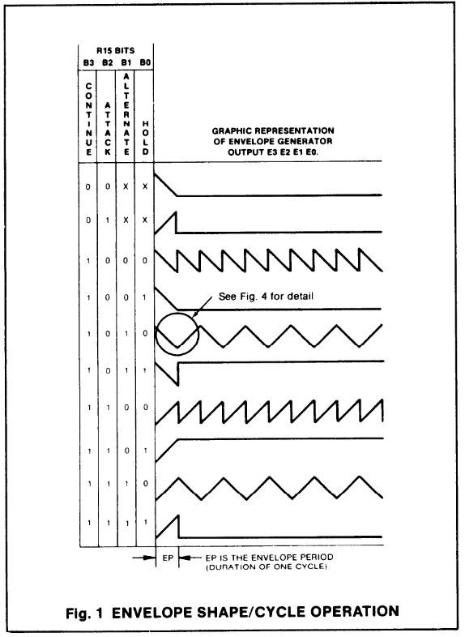
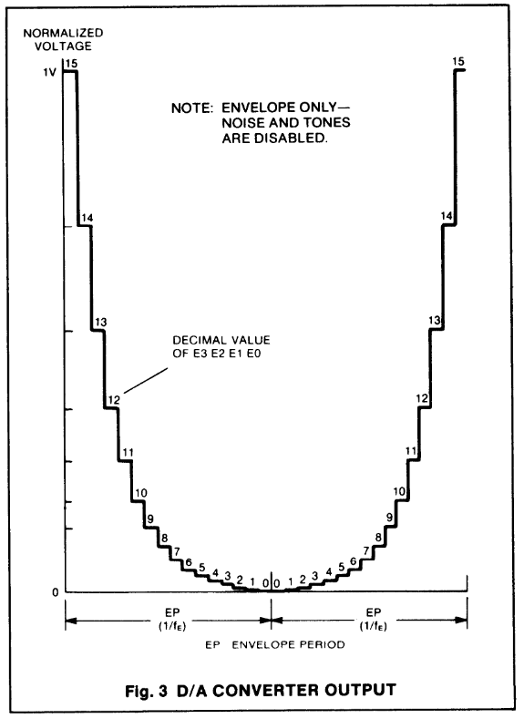

# 04. Sound

Sound in the Aleste is the AY-3-8910 chip. The same one that was in the Amstrad CPC, MSX, ZX Spectrum 128, and a bunch of other machines of that era. If you have ever programmed sound on any of these platforms — everything here will be familiar.

If not — no problem. The chip is simple.

## What the AY-3-8910 can do

Three independent tone channels. Each can generate a square wave of a given frequency. Plus one noise generator that can be mixed into any channel. Plus a hardware envelope generator that controls a channel's volume along a given curve.

Total: three voices, noise, envelope. For music and sound effects that is more than enough.

The chip runs at a clock frequency of 1 MHz. This is important for calculating note frequencies.

## How to reach the AY

The Z80 has no direct access to the AY. The chip is connected through an intermediary — the 8255 parallel interface (PPI). This is the standard scheme in the CPC.

The AY has 16 internal registers. To write to one of them, you need to:

1. Put the register number on the AY data bus.
2. Set the BC1 and BDIR control signals so that the AY understands: "this is a register address."
3. Put the value on the data bus.
4. Set BC1 and BDIR so that the AY understands: "this is data."

The AY data bus is connected to port A of the 8255 chip. The BC1 and BDIR control signals are connected to port C.

Ports:

| Port    | What       | Purpose                |
|---------|------------|------------------------|
| `#F4XX` | PPI Port A | Data for the AY        |
| `#F6XX` | PPI Port C | Control (BC1, BDIR)    |

Port C bits:

```txt
bit 7 — BDIR
bit 6 — BC1
```

BC1/BDIR combinations:

| BDIR | BC1 | What it does                |
|------|-----|-----------------------------|
| 0    | 0   | Inactive                    |
| 0    | 1   | Read data from the AY       |
| 1    | 0   | Write data to the AY        |
| 1    | 1   | Write register address to the AY |

Sequence for writing to an AY register:

1. Put the register number (0–15) on port A.
2. Set BDIR=1, BC1=1 on port C (write address).
3. Set BDIR=0, BC1=0 on port C (reset).
4. Put the value on port A.
5. Set BDIR=1, BC1=0 on port C (write data).
6. Set BDIR=0, BC1=0 on port C (reset).

That's six steps per write. Tedious, but that's how the hardware works. The BIOS has ready-made functions `WR_PSG` and `RD_PSG` that do all this for you. On the Aleste it is recommended to use exactly these, rather than poking the ports directly.

## AY registers

There are 16 registers in total, 0 through 15.

| Register | What                              |
|----------|-----------------------------------|
| 0        | Channel A frequency, low byte     |
| 1        | Channel A frequency, high 4 bits  |
| 2        | Channel B frequency, low byte     |
| 3        | Channel B frequency, high 4 bits  |
| 4        | Channel C frequency, low byte     |
| 5        | Channel C frequency, high 4 bits  |
| 6        | Noise frequency (5 bits)          |
| 7        | Channel and noise enable          |
| 8        | Channel A volume                  |
| 9        | Channel B volume                  |
| 10       | Channel C volume                  |
| 11       | Envelope period, low byte         |
| 12       | Envelope period, high byte        |
| 13       | Envelope shape                    |
| 14       | Port A (read) — keyboard          |
| 15       | Port B (write) — printer data     |

Registers 14 and 15 are not sound but additional I/O through the AY. On the Aleste, register 15 is used for the printer (see the ports section), and register 14 is used for reading the keyboard.

## Note frequency

The tone frequency is set by a 12-bit value: the low 8 bits go in the `lo` register, the high 4 in the `hi` register. The chip divides the clock frequency (1 MHz) by this value to get the output signal frequency.

Formula:

```txt
output_frequency = 1000000 / (16 * value)
```

Hence:

```txt
value = 1000000 / (16 * frequency)
```

For example, for the note "A" of the first octave (440 Hz):

```txt
value = 1000000 / (16 * 440) = 142
```

This value is placed in the channel registers: low byte (142) and high 4 bits (0).

Example: turn on a 440 Hz note on channel A.

```txt
; Set the frequency
LD A, 0            ; register 0 = low byte of frequency A
LD E, 142          ; value
CALL WR_PSG        ; BIOS function: write E to register A

LD A, 1            ; register 1 = high 4 bits of frequency A
LD E, 0
CALL WR_PSG

; Enable channel A (bit 0 of register 7)
LD A, 7
LD E, %00111110    ; channel A on, B and C off, noise off
CALL WR_PSG

; Set channel A volume (register 8)
LD A, 8
LD E, 15           ; maximum volume
CALL WR_PSG
```

Done, the note plays.

## Register 7: what is enabled

This register controls which channels and sound sources are active.

| Bit | What                             |
|-----|----------------------------------|
| 0   | Channel A: tone on/off           |
| 1   | Channel B: tone on/off           |
| 2   | Channel C: tone on/off           |
| 3   | Channel A: noise on/off          |
| 4   | Channel B: noise on/off          |
| 5   | Channel C: noise on/off          |
| 6   | Port A: 0 = read, 1 = write      |
| 7   | Port B: 0 = read, 1 = write      |

For tone: bit = 0 enables tone, 1 disables.
For noise: bit = 0 enables noise, 1 disables.

That is, the logic is inverted — not "1 means enabled," but "0 means enabled." This is the classic AY trap, and you need to remember it.

For example, `%00111110` means: channel A tone enabled (bit 0 = 0), channels B and C tone disabled (bits 1 and 2 = 1), noise on all channels disabled (bits 3, 4, 5 = 1).

## Volume

Registers 8, 9, 10 are the volume of channels A, B, C.

Values:

- 0–15 — direct volume (0 = quiet, 15 = loud).
- 16 and above — the channel is controlled by the envelope.

Usually 0–15 are used, and the envelope only when you need automatic decay or attack.

## Noise

Register 6 sets the noise frequency, 5 bits (values 0–31). The smaller the value, the higher the noise frequency (that is, the "hiss" is higher). The larger — the lower, down to a rumble.

Noise can be mixed into any channel by setting the corresponding bit in register 7. This gives various effects: percussion, explosions, hissing.

## Envelope

The envelope is an automatic change of a channel's volume along a given curve. Useful for decay effects, for bass lines, for "falling" sounds.

Registers:

- 11, 12 — envelope period (16 bits).
- 13 — envelope shape (16 variants).

The shapes include: sawtooth up, sawtooth down, triangle, square wave, single pulse, and their variations. The full table is in the AY-3-8910 datasheet; I won't reproduce it here: it is rarely needed manually, usually musicians use ready-made trackers.

For a channel to be controlled by the envelope, you must write the value 16 or greater (usually 16) to its volume register.

## Playing music

Poking the AY registers by hand for every note is inconvenient. Usually music is written in a tracker and then played by a player program that reads the data and updates the AY registers at the required rate (usually 50 Hz, on the interrupt from the raster).

For the Aleste there are ported trackers and players from the CPC and MSX. If you need music — find a ready-made player, don't write your own from scratch.

## Stereo

The Aleste documentation mentions "stereo." But the AY-3-8910 is a mono chip. Three channels, but they all go to one output.

Stereo in the Aleste is most likely implemented by external means: for example, individual channels are routed to different outputs through additional circuitry. But there is no precise information about this, and at the AY programming level it remains mono.

If you need true stereo sound — look toward the Magic Sound Board (see the mention in the expansions section). This is a separate board with DMA sound, but it is not part of the base Aleste configuration.

## Accessing the AY through the BIOS

The Aleste BIOS has two functions for working with the AY:

- `WR_PSG` — write a value to an AY register.
- `RD_PSG` — read a value from an AY register.

The exact addresses and parameters are in the BIOS documentation. Using them is simpler and more reliable than poking the 8255 ports directly.

If the BIOS is unavailable (for example, you have disabled it), you can poke the ports directly:

```asm
; Write value E to register A
; A = register number, E = value
WR_PSG:     DI
            PUSH BC
            LD B,0F4H
            OUT (C),D        ; port A = register number (D)
            LD B,0F6H
            IN A,(C)         ; read the current state of port C
            OR 0C0H          ; BC1=1, BDIR=1 (write address)
            OUT (C),A
            AND 3FH          ; reset BC1/BDIR
            OUT (C),A
            LD B,0F4H
            OUT (C),E        ; port A = value (E)
            LD B,0F6H
            LD C,A
            OR 80H           ; BC1=0, BDIR=1 (write data)
            OUT (C),A
            OUT (C),C        ; reset
            POP BC
            EI
            RET
```

But this is slow, tedious, and easy to get wrong. BIOS functions exist precisely so you don't have to deal with this.

## Practical tips

**Use the BIOS functions.** `WR_PSG` and `RD_PSG` are your friends.

**Remember the inversion in register 7.** 0 enables, 1 disables. This is non-obvious and often becomes the source of "why doesn't it play."

**Don't forget the volume.** People often forget to set register 8, and the note "plays" but you can't hear it.

**For music — use a ready-made player.** Don't write your own tracker unless you want to spend a month.

**Be careful with the envelope.** Envelope shapes are a separate topic, and without the datasheet it's easy to get confused.

## What's next

The built-in sound is covered. The next section is [the external sampler synthesizer board MagicSound](05-magicsound.md).

# Cross-checking the `04. Sound` documentation against the old table

In short: **the docs are generally sufficient**, but the old table adds a few details that are not in `04. Sound` or are presented less precisely there. There is no need to duplicate it fully in the main text — it is better to have **an appendix in Markdown** with this table (redrawn) plus a couple of clarifications in the main text.

---

## 1. What matches

- The AY-3-8910 chip, 1 MHz clock — yes.
- 16 registers (0–15) and their purpose — matches.
- Register 7 — the mixer, inversion (0 = On, 1 = Off) — matches, and the doc emphasizes this.
- Registers 11/12 — envelope period, 13 — shape — matches.
- Registers 14/15 — keyboard and Centronics printer — matches (the doc doesn't name Centronics explicitly, but that's a minor point).
- `WR_PSG` / `RD_PSG` as BIOS functions — matches.

## 2. What the table adds or clarifies

1. **Registers 1, 3, 5 — only D0–D3.** The doc says "high 4 bits" — correct, but the table states directly "high byte (D0-D3)," i.e. **bits 4–7 are ignored**. This is worth noting explicitly: when writing to the `hi` register you need to mask the value with `AND 0Fh`, otherwise you can accidentally set extra bits (on a real AY the upper bits are unused, but it's better not to rely on that).
2. **Register 6 — "noise generator frequency,"** without stating the bit width. The doc says "5 bits (0–31)" — this is correct for the AY-3-8910, but the table neither confirms nor denies it. We leave it as is, but can reference the datasheet.
3. **Register 13 — the full table of 16 envelope shapes with images.** The doc says "16 variants, the full table is in the datasheet, I won't reproduce it." The old table actually **provides this table** (albeit with ASCII graphics). This is the main value of the old table — it is worth preserving in the appendix, redrawn carefully.
4. **Register 15 — explicitly "printer data (Centronics)."** The doc says "printer data (see the ports section)" — one can add the word Centronics for precision.
5. **Register 7, bits 6 and 7 — port A and B direction.** Present in the doc, matches.

## 3. What is not in the old table but is in the doc (and that's good)

- The frequency formula `1000000 / (16 * value)` — not in the table.
- The 440 Hz note example — no.
- The step-by-step BC1/BDIR sequence — no.
- The section on stereo, players, practical tips — no.
- The clarification that volume 16+ = envelope — not explicit in the table (just "volume"), explicit in the doc.

That is, **the docs are richer in practice**, the table is more precise on the "hardware" side (bit width, envelope shapes, Centronics).

---

## 4. Recommendation

**Yes, it is worth making a Markdown appendix.** But not as "the old table verbatim," rather as **a carefully redrawn reference table** preserving all the details, plus short explanations that are not in the main doc. The main text of `04. Sound` can be supplemented with three small edits:

1. In the "AY registers" section, for registers 1/3/5 add: "only D0–D3 are used, bits 4–7 are ignored; when writing, mask with `AND 0Fh`."
2. In the "AY registers" section, for register 15 add "(Centronics)."
3. In the "Envelope" section, replace "the full table is in the datasheet, I won't reproduce it here" with "the full table of 16 shapes is in Appendix A" (and provide it there).

---

# Appendix A. AY-3-8910 register reference

The AY-3-8910 chip, clock frequency 1 MHz. Access — through the BIOS functions `WR_PSG` (write) and `RD_PSG` (read).

## A.1. Registers

| Register | Purpose                                            | Bit width / note                        |
|---------:|----------------------------------------------------|-----------------------------------------|
|        0 | Channel A frequency, low byte                      | D0–D7                                   |
|        1 | Channel A frequency, high byte                     | **only D0–D3**, bits 4–7 ignored        |
|        2 | Channel B frequency, low byte                      | D0–D7                                   |
|        3 | Channel B frequency, high byte                     | **only D0–D3**                          |
|        4 | Channel C frequency, low byte                      | D0–D7                                   |
|        5 | Channel C frequency, high byte                     | **only D0–D3**                          |
|        6 | Noise generator frequency                          | 5 bits (0–31), see datasheet            |
|        7 | Mixer (see A.2)                                    | —                                       |
|        8 | Channel A volume                                   | 0–15 direct; 16+ — envelope control     |
|        9 | Channel B volume                                   | same                                    |
|       10 | Channel C volume                                   | same                                    |
|       11 | Envelope period, low byte                          | D0–D7                                   |
|       12 | Envelope period, high byte                         | D0–D7                                   |
|       13 | Envelope shape (see A.3)                           | 4 bits (D0–D3), 16 variants             |
|       14 | Port A (read) — keyboard                           | —                                       |
|       15 | Port B (write) — printer data (Centronics)         | —                                       |

## A.2. Register 7 — mixer

| Bit | Purpose             | Logic                  |
|-----|---------------------|------------------------|
| D0  | Channel A tone      | 0 = On, 1 = Off        |
| D1  | Channel B tone      | 0 = On, 1 = Off        |
| D2  | Channel C tone      | 0 = On, 1 = Off        |
| D3  | Noise in channel A  | 0 = On, 1 = Off        |
| D4  | Noise in channel B  | 0 = On, 1 = Off        |
| D5  | Noise in channel C  | 0 = On, 1 = Off        |
| D6  | Port A direction    | 0 = read, 1 = write    |
| D7  | Port B direction    | 0 = read, 1 = write    |

Reminder: the logic is inverted — **0 enables, 1 disables**.

## A.3. Register 13 — envelope shapes

16 variants, set by bits D3–D0. Below — ASCII diagrams (from the old Patisonic table).



The exact graphs and timings are in the AY-3-8910 datasheet. In practice the ones most often needed are `1000b` (sawtooth down, repeat) and `1110b` (triangle) for decays and "falling" sounds.

## A.4. Output DAC characteristics

The output signal has a logarithmic volume scale; moreover, even with the generator off, the voltage of the volume register is fed to the output. This feature is used for software FM or sampler synthesis.



## A.5. Quick example: 440 Hz note on channel A

```asm
; Frequency: 1000000 / (16 * 440) = 142
LD A, 0            ; register 0 — low byte of frequency A
LD E, 142
CALL WR_PSG

LD A, 1            ; register 1 — high 4 bits of frequency A
LD E, 0            ; (only D0–D3!)
CALL WR_PSG

LD A, 7            ; mixer: channel A tone On, the rest Off
LD E, %00111110
CALL WR_PSG

LD A, 8            ; channel A volume
LD E, 15
CALL WR_PSG
```

