# Notes on Video Display Units in Amstrad CPC

This document describes the two chips involved in the video output of Amstrad CPC computers. The two chips are CRTC (HD6845) and Gate Array (40010). CRTC is responsible for generating CRT timings and memory addresses, and Gate Array does conversion from data to RGB signals along with other CPC specific tasks.

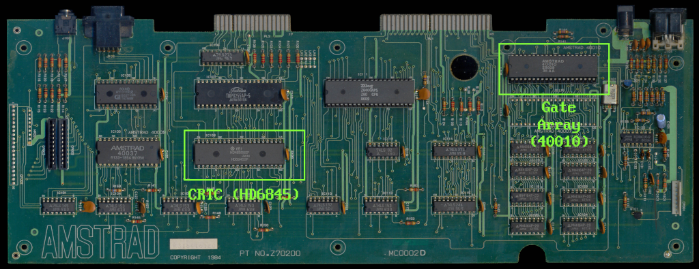
*Amstrad CPC 464, CRTC and Gate Array outlined (board photo taken from CPCWiki)*

## 1 CRTC (Motorola HD6845)

Amstrad CPC contains Motorola 6845 Cathode Ray Tube Controller on its board as part of display generation along with a custom ASIC gate array marked as 40010. What 6845 primarily does is to generate CRT signals such as Horizontal Sync and Vertical Sync as well as video memory addresses to fetch pixel data. Gate Array works together in sync with CRTC, and is responsible for converting the pixel data in memory into video signals through an R2R DAC.

Motorola 6845 was used for other computers at the time, most notably the early IBM PC compatibles with CGA video cards, and the later standards such as EGA and VGA were compatible with it. It is advised to study the datasheet for Motorola 6845 in detail for the block and timing diagrams to understand how it works.

Additionally, in the context of Amstrad CPC computers, we need to know how it's interfaced on the board with the rest of the system. Here I will provide notes about the display mechanism of Amstrad CPC.

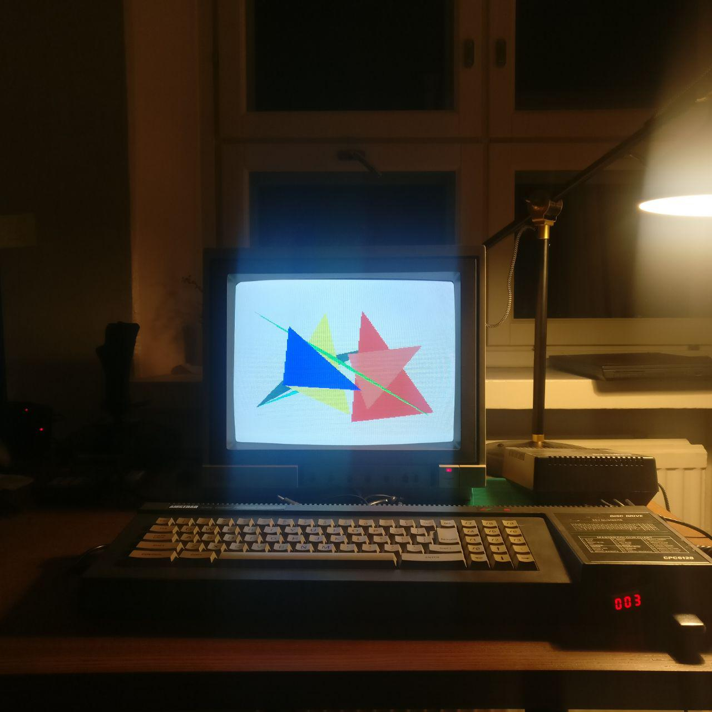
*Amstrad CPC 6128 with a 1084 monitor.*

> *Motorola MC6845 from Wikipedia.*
> 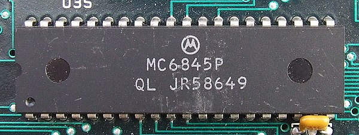

### 1.1 Port Mapping

CRTC registers are port mapped as follows:

| I/O port address | Function         | Read/Write |
|------------------|------------------|------------|
| &BCxx            | 6845 CRTC Index  | Write only |
| &BDxx            | 6845 CRTC Write  | Write only |
| &BExx            | 6845 CRTC Status | Read only  |
| &BFxx            | 6845 CRTC Read   | Read only  |

### 1.2 Registers

6845 has 16 programmable registers. Detailed descriptions are found in the datasheet. For advanced graphical tricks and effects, it is very important to understand the internals of the specific 6845 variant. For this purpose, one must consult the block diagram and timing waveforms found in the datasheet.

| Register Index | Register Name                       | Default value |
|----------------|-------------------------------------|---------------|
| 0              | Horizontal Total                    | 63            |
| 1              | Horizontal Displayed                | 40            |
| 2              | Horizontal Sync Position            | 46            |
| 3              | Horizontal and Vertical Sync Widths | 128+14        |
| 4              | Vertical Total                      | 38            |
| 5              | Vertical Total Adjust               | 0             |
| 6              | Vertical Displayed                  | 25            |
| 7              | Vertical Sync position              | 30            |
| 8              | Interlace and Skew                  | 0             |
| 9              | Maximum Raster Address              | 7             |
| 10             | Cursor Start Raster                 | 0             |
| 11             | Cursor End Raster                   | 0             |
| 12             | Display Start Address (High)        | 48            |
| 13             | Display Start Address (Low)         | 0             |
| 14             | Cursor Address (High)               | 0             |
| 15             | Cursor Address (High)               | 0             |
| 16             | Light Pen Address (High)            | 0             |
| 17             | Light Pen Address (High)            | 0             |

To experiment with the result of each register you can set them from BASIC.

### 1.3 Example: Set CRTC Register Values from BASIC

The following will set Register 1 to the value 42:

```
OUT &BC00, 1:OUT &BD00, 42
```

### 1.4 CRTC and Address Bus

Below is the wiring of 6845 to address bus:

```
Address Bus         CRTC Master Address
                    And Raster Address pin-outs
===========         ===========================

A 0 - ----------- - CCLK ---> Gate Array 1 Mhz clock
A 1 - ----------- - MA 0 -+
A 2 - ----------- - MA 1  |
A 3 - ----------- - MA 2  |
A 4 - ----------- - MA 3  |
A 5 - ----------- - MA 4  |
A 6 - ----------- - MA 5  |
A 7 - ----------- - MA 6  +-> 6845 Memory Address pins
A 8 - ----------- - MA 7  |
A 9 - ----------- - MA 8  |
A10 - ----------- - MA 9  |
A11 - \           x MA10  |
A12 - \-\         x MA11  |
A13 - \-\-\ ----- - MA12  |
A14 - --\-\-\---- - MA13 -+
A15 - ----\-\-\
           -\-\-- - RA0  -+
             -\-- - RA1   |
               -- - RA2   +-> 6845 Raster Address pins
                  x RA3   |
                  x RA4  -+n
```

### 1.5 Observations

- Note that the pins MA10 and MA11 are grounded. So are the last two of the RA pins. CCLK, and from MA0 to MA9 form the first 11 bits (keep the following figures in mind: `2^11 == 2048 == 0x800`) of the address register. The remaining top 5 bits of the address registers are formed by a cross wiring of RA0, RA1, RA2 and MA12, MA13 pins. We'll see why this is the case.
- As described in CRTC datasheet, 14-bit MA counter is reset to the values of 8-bit registers R12 and R13 of CRTC at the beginning of each field (or frame). RA13 is the low byte and RA12 is the high byte of the reset value.
- CRTC is interfaced in a fixed manner to enable text based addressing easier.
- RA counter increments the refresh address by `2^11` (`0x800`, or 2048 bytes). Current raster line within the character line is calculated as `RA * 0x800`, or `(y1 % 8) * 2048`, where y1 is the scan-line counter on the entire frame.
- MA10 and MA11 are ineffective except when both are set high, which causes an overflow to MA12 and MA13 when MA counter is incremented enough by CRTC. This is used for achieving fullscreen (aka overscan) that covers two pages (`0x8000`, 32K), which will be covered later.
- MA12 and MA13 increments the screen refresh address by `2^14` (`0x4000`, 16K). The current video bank is calculated as `(MA12,MA13) * 0x4000`. Video banks are `0x0000`, `0x4000`, `0x8000` or `0xc000`. In order to achieve Fullscreen, MA10 and M11 should be set, so that the video addresses are from `0x0000` to `0x7fff`, or from `0x8000` to `0xffff` depending on the MA reset value.

### 1.6 Character Addressing

Video addressing is designed for text mode. Default value for R1 (Horizontal Displayed) is 40, and R6 (Vertical Displayed) is 25. This means that the screen is 40 characters wide, and 25 characters tall, 1000 in total.

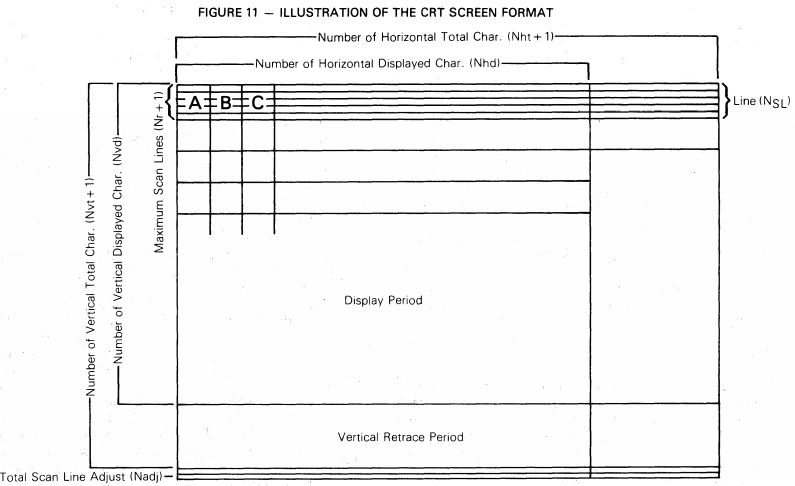

The entire screen character addresses, with the default CRTC register values, are from `0xc000` to `0xc7ff`. In mode 1, one character is 2 bytes wide, encoding 2-bit color information. So, the position of a character can be addressed as `0xc000 + 80 * y + x * 2`.

The following BASIC program demonstrates the character addressing:

```basic
FOR I=&C000 to &C7FF: POKE I, &FF: NEXT
```

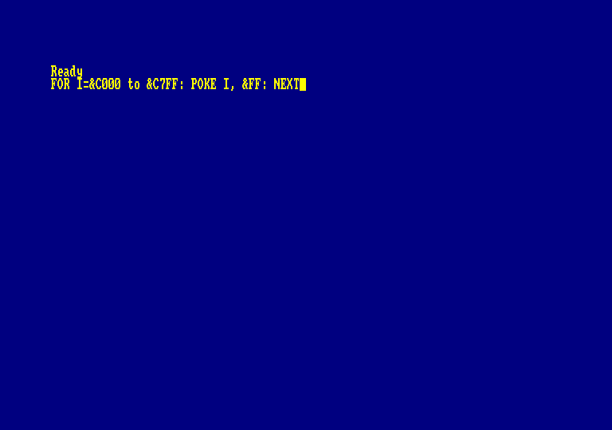

If you are careful, you will notice that even though a 40x25 character screen takes 1000 characters in total, which takes 2000 bytes space in memory, CRTC jumps 2048 (`0x800`) bytes for every subsequent scanline of a character. The extra 48 bytes is simply not visible on a static screen. However, when the screen is scrolled, they will become visible. Also, since there are 8 scanlines for a character row, it means in total `8 * 48`, there are 384 bytes of undisplayed video memory.

### 1.7 Timing

As per PAL standard requirements, CRTC is expected to produce `HSYNC` every 64 microseconds (decided by R1 + 1 of CRTC), and `VSYNC` every 312 scanlines (decided by R4 + 1 * R9 + 1, and by default `64 * 312 = 19968` microsceonds), which amounts to a 50hz display refresh rate. Not meeting this criteria will not produce a stable image.

CRTC consists of a bunch of registers, internal counters and comparators. The way they are wired slightly differ between different 6845 implementations.

Note: The following sections are taken from CAST's C6845 datasheet:

#### 1.7.1 Block Diagram

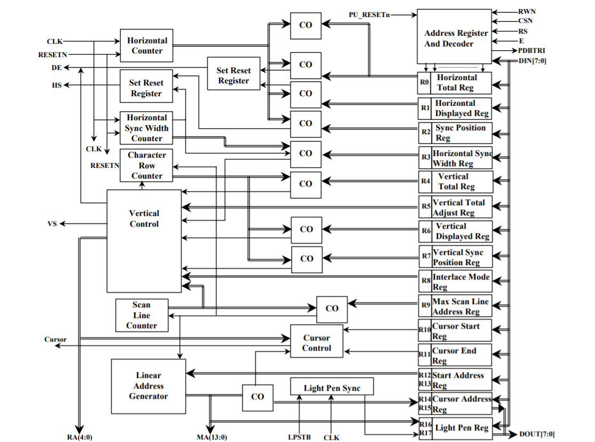

#### 1.7.2 Horizontal timing

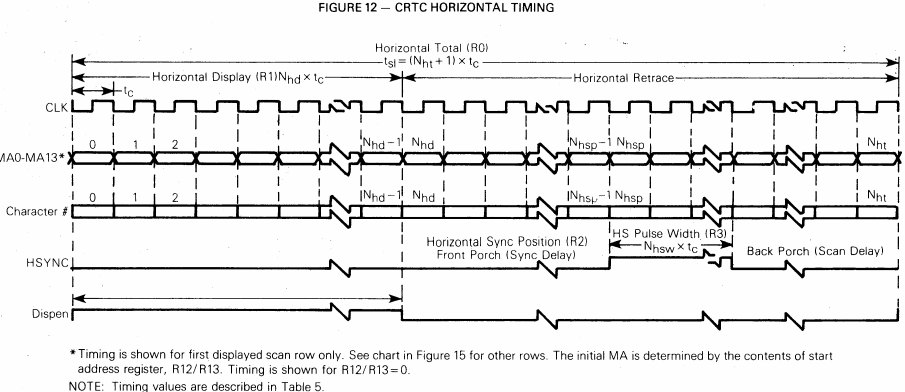

"The Horizontal Timing section consist of the Horizontal Counter, Horizontal Sync Width Counter, Registers R0 through R3, and associated synchronous Set/Reset Flip-Flops and Coincidence Circuits.

The Horizontal Counter counts from zero until coincidence with Register R0 synchronously resets the counter. This represents the horizontal line rate and enabling of the Display Enable (DE) for a new line takes place.

Coincidence of the Horizontal Counter with Register R1 marks the end of the active display portion of a horizontal line with Display Enable (DE) going inactive.

Coincidence of the Horizontal Counter with Register R2 marks the beginning of horizontal retrace with Horizontal Sync (HS) going active high.

Coincidence of the Horizontal Sync Width Counter with Register R3 marks the end of horizontal retrace with Horizontal Sync (HS) going inactive low." (CAST's C6845 datasheet)

#### 1.7.3 Vertical timing

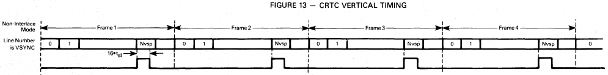

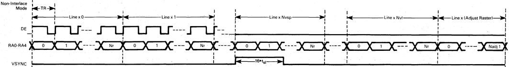

"The Vertical Timing section consists of the Scan Line Counter, Character Row Counter, Registers R4 through R9, the Vertical Control logic block, and associated Coincidence Circuits.

The Scan Line Counter counts from zero until coincidence with Register R9 synchronously resets the Scan Line Counter and synchronously increments the Character Row Counter. The Scan Line Counter counts the Scan Lines composing a character row, and the Character Row Counter counts the character rows comprising a vertical frame.

The Character Row Counter coincidence with R4 and the residual Scan Line count represented by R5 marks the end of a vertical frame.

The Character Row Counter coincidence with Register R6 marks the end of the active display portion of the vertical frame measured in character rows.

The Character Row Counter coincidence with Register R7 marks the beginning of vertical retrace with Vertical Sync (VS) going active high. VS remains high for a fixed period of 16 scan lines.

Register R8, Interlace Mode Register, effects the Vertical Timing according to its programming. Normal Sync (Non-Interlace) mode displays the same field each frame. Interlace Sync Mode splits a frame into even and odd fields. Vertical Sync (VS) active high is delayed one-half scan line at the end of even fields. For Interlace Sync & Video Mode, in addition to the VS delay on even fields, the Row Address counter sequences on even fields through 0,2,4,… counter values while on odd fields, through 1,3,5,… counter values." (CAST's C6845 datasheet)

#### 1.7.4 Start address timing

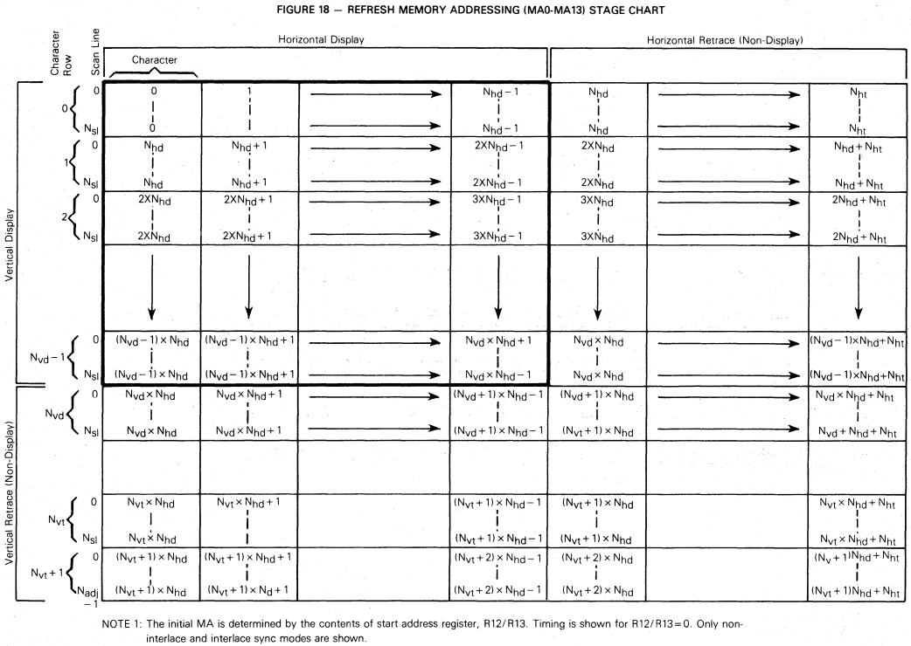

"Start Address Register R12 and R13 indicate the first address the Linear Address Generator puts on the Refresh Memory Address bus at the start of a vertical frame. Whenever the microprocessor writes to R12 and R13, the Linear Address Generator is updated at the start of the next vertical frame." (CAST's C6845 datasheet)

## 2 Gate Array (40010)

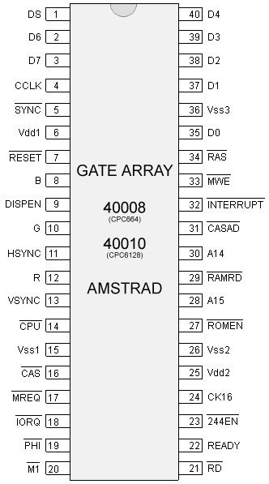
*Gate Array pinout diagram(source: Grimware)*

Gate Array is a custom ASIC designed by Amstrad. Periodically it reads the data available on the data bus as set by CRTC's memory address pins, and converts them to analog video signals based on the selected screen mode specific pixel format. It is also responsible for memory banking, storing color palette, border color, and issuing an interrupt that pulses every 52th horizontal sync signal.

### 2.1 Port Mapping

Gate Array is port mapped to the address `0x7f00`, and provide the following interface:

| Bit 7 | Bit 6 | Register | Function                                                   |
|-------|-------|----------|------------------------------------------------------------|
| 0     | 0     | PENR     | Select pen                                                 |
| 0     | 1     | INKR     | Select colour for selected pen                             |
| 1     | 0     | RMR      | Select screen mode, rom configuration and interrupt control|
| 1     | 1     | MMR      | RAM Memory Management                                      |

For more details on the parameters of each command, see: http://cpcwiki.eu/index.php/Gate_Array

### 2.2 Commands

#### 2.2.1 0 PENR - Select Pen

| 7 | 6 | 5 | 4 | 3 | 2 | 1 | 0 | Description   |
|---|---|---|---|---|---|---|---|---|
| 0 | 0 | - | 1 | - | - | - | - | Select Border |
| 0 | 0 | - | 0 | x | x | x | x | Select Pen    |

#### 2.2.2 1 INKR - Select Color for Selected Pen

| 7 | 6 | 5 | 4 | 3 | 2 | 1 | 0 | Description  |
|---|---|---|---|---|---|---|---|---|
| 0 | 1 | - | x | x | x | x | x | Color number |

#### 2.2.3 2 RMR - Select screen mode, rom configuration and interrupt control

| 7 | 6 | 5 | 4 | 3 | 2 | 1 | 0 | Description                     |
|---|---|---|---|---|---|---|---|---|
| 1 | 0 | - | x | y | y | z | z | x: Interrupt generation control |
|   |   |   |   |   |   |   |   | y: Upper/Lower ROM disable flag |
|   |   |   |   |   |   |   |   | z: Screen mode selection        |

#### 2.2.4 3 MMR - RAM Memory Management

| 0 | 1 | 2 | 3 | 4 | 5 | 6 | 7 | Description                            |
|---|---|---|---|---|---|---|---|---|
| 1 | 1 | x | x | x | y | y | y | x: 64K bank number for expansion ports |
|   |   |   |   |   |   |   |   | y: RAM config                          |

##### 2.2.4.1 RAM config

| Address   | 0 | 1 | 2 | 3 | 4 | 5 | 6 | 7 |
|-----------|----|----|----|----|----|----|----|----|
| 0000-3fff | 0  | 0  | 4  | 0  | 0  | 0  | 0  | 0  |
| 4000-7fff | 1  | 1  | 5  | 3  | 4  | 5  | 6  | 7  |
| 8000-bfff | 2  | 2  | 6  | 2  | 2  | 2  | 2  | 2  |
| c000-ffff | 3  | 7  | 7  | 7  | 3  | 3  | 3  | 3  |

### 2.3 Color Pixel Format

Color pixel format is described in the firmware manual in detail. Here the C macros are provided for conversion from ink color to byte and vice versa, along with a table representation.

#### 2.3.1 Pixel/Ink Conversion Macros

```c
#define MODE_1_P0(c) (((c & 2) >> 1) << 3) | ((c & 1) << 7)
#define MODE_1_P1(c) (((c & 2) >> 1) << 2) | ((c & 1) << 6)
#define MODE_1_P2(c) (((c & 2) >> 1) << 1) | ((c & 1) << 5)
#define MODE_1_P3(c) (((c & 2) >> 1) << 0) | ((c & 1) << 4)

#define MODE_0_P0(c) ((c & 8) >> 2) | ((c & 4) << 3) | ((c & 2) << 2) | ((c & 1) << 7)
#define MODE_0_P1(c) ((c & 8) >> 3) | ((c & 4) << 2) | ((c & 2) << 1) | ((c & 1) << 6)
```

As you can see from the way bits shuffled around:

- Each mode 2 byte contains 8, 1-bit (1 color) pixel.
- Each mode 1 byte contains 4, 2-bit (4 color) pixels.
- Each mode 0 byte contains 2, 4-bit (16 color) pixels.

#### 2.3.2 Table Representation

```
+-----------+---------------------------------------+-----------------------------------------------------------------------------------+
|           |           Byte/Pixel structure        |                                                                                   |
|-----------+----+----+----+----+----+----+----+----+-------------------------------+---------------------------------------------------|
| VM (Mode) | 7  | 6  | 5  | 4  | 3  | 2  | 1  | 0  | On screen display             | Details                                           |
|-----------+----+----+----+----+----+----+----+----+---------------+---------------+---------------------------------------------------|
| %00 (0)   | A0 | B0 | A2 | B2 | A1 | B1 | A3 | B3 | A             | B             | 4bits/pixels (16 colors), 2 pixels/byte (160×200) |
|-----------+----+----+----+----+----+----+----+----+-------+-------+-------+-------+---------------------------------------------------|
| %01 (1)   | A0 | B0 | C0 | D0 | A1 | B1 | C1 | D1 | A     | B     | C     | D     | 2bits/pixels (4 colors), 4 pixels/byte (320×200)  |
|-----------+----+----+----+----+----+----+----+----+---+---+---+---+---+---+---+---+---------------------------------------------------|
| %10 (2)   | A  | B  | C  | D  | E  | F  | G  | H  | A | B | C | D | E | F | G | H | 1bit/pixel (2 colors), 8 pixels/byte (640×200)    |
+-----------+----+----+----+----+----+----+----+----+---+---+---+---+---+---+---+---+---------------------------------------------------+
```

### 2.4 Memory Addressing

Gate Array can only see the same first 4 banks of memory (from 0 to 0xffff) regardless of the memory banking scheme configured.

### 2.5 Timing

Gate Array is connected to a 16Mhz clock signal, which is then divided to 4Mhz to feed the Z80, and 1Mhz for the CRTC. Gate Array's READY signal is connected to Z80's WAIT input for "memory contention". This means CPU execution is halted every time Gate Array and CPU accesses the memory at the same time. The reason for this is that both GA and the CPU share the same address/data bus for memory access.

Z80 User Manual states:

> During T2 and every subsequent automatic WAIT state (TW), the CPU samples the WAIT line with the falling edge of the clock.

That is, most of the time, CPU will wait only when WAIT is active during T2, which is 1 out of 4 or more T states that constitutes a machine cycle (M). Incidentally, Gate Array releases WAIT pin 1 out of every 4 clock cycles.

This means, Z80 and GA are accessing the memory in alternating order. This is not always the case, though. If Z80 samples WAIT when GA is accessing the memory, which do occur, then Z80 will wait until GA releases it, after which they will be in synchronization until another overlap occurs.

### 2.6 Interrupts

There is an internal 6-bit counter which gets incremented on each HYSNC signal. When it equals 52, the counter is set to zero. Since a frame is composed of 312 HSYNCs, at most 6 interrupts are generated per frame.

When the bit 4 of RMR command is set, it will clear the HSYNC counter.

After a VSYNC signal is "sensed", the counter is cleared. When that happens if the 6th bit of the counter was 0 (i.e. <32) then an interrupt is generated, otherwise no interrupt is generated. This event is observed to occur at the end of the 2nd HSYNC signal after VSYNC bit of PORT B is latched.

Unless the interrupt is cleared by the Z80, when a VSYNC occur, the counter will always be >= 32 (at the value of 52).

Typically a HALT instruction after polling VSYNC bit of PORT B will allow synchronizing to the frame:

```asm
        ld      b, #f5          ; Port B of 8255
vsync1  in      a, (c)
        rra                     ; Push bit 0 into carry
        jr      nc, vsync1      ; Carry is set when VSYNC is active

        halt                    ; Synchronized to the beam
```

The reason HALT is needed for a perfect synchronization is because the code for polling VSYNC will have a variable clock cycle difference at the end. If no HALT is issued, it is not possible to know exactly where the Z80 code is synced with respect to the screen.

The next interrupt is generated two HSYNCs after a VSYNC, which means when the Z80 wakes up after a HALT it will have slept for ~128 microseconds in addition to the amount of time spent in the interrupt routine.

## 3 Examples

### 3.1 Drawing Characters

The characters consist of scanlines that amount to the value of `R9 + 1`, 8 by default. The number of bytes required for each character depends on the graphical mode: 1 byte in Mode 2, 2 bytes in Mode 1, and 4 bytes in Mode 0.

The subsequent scanlines of every character are `&800` bytes apart from each other. For instance, each address line for the character at `&c000` is calculated with `&c000 + y * &800`.

```basic
10 MODE 2
20 DATA &18,&3c,&7e,&ff,&ff,&7e,&3c,&18  : ' Load some 8 by 8 bitmap data
30 INPUT "x pos";x :INPUT "y pos";y
34 '
35 ' Text render begin
36 '
40 addr = &C000 + y * 80 + x             : ' Calculate screen start address
60 FOR y0 = 0 TO 7                       : ' For 8 pixels high
70 READ p                                : ' Read pixel data
80 POKE addr, p                          : ' Poke it at screen address
90 addr = addr + &800                    : ' Calculate next line's screen address
100 NEXT
105 '
106 ' Text render end
107 '
110 END
```

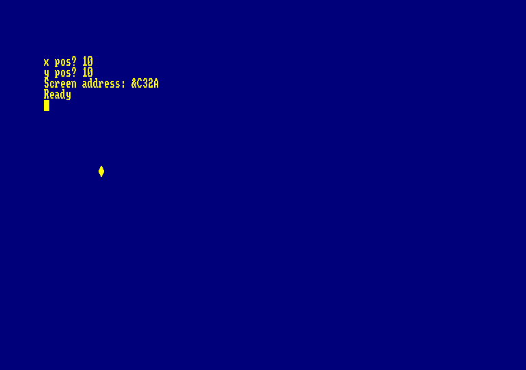

### 3.2 Hardware Scrolling

Hardware scrolling in any direction is achieved by changing the display start address through `R12` and `R13` registers of CRTC. Incrementing memory address register by one will shift the screen by 1 character in "mode 1". However, as you will realize, this corresponds to 2 bytes due to address bus interfacing described earlier. That is, setting R13 from 0 to 1 will result in the memory address to start from `0xc002`. Important thing to note is that when the screen is scrolled, it will wrap around. You will have to do redrawing for the areas that become visible.

Since the amount of pixels scrolled is 2 bytes this can be considered "coarse" scrolling. Smoother scrolling require more complex tricks, and different techniques are employed for both vertical and horizontal smooth scrolling.

The following BASIC program demonstrates the coarse scrolling by setting the R12 and R13 registers based on keyboard input.

```basic
10 ma%=0
20 IF INKEY(1)=0 THEN GOSUB 100
30 IF INKEY(2)=0 THEN GOSUB 300
40 IF INKEY(8)=0 THEN GOSUB 500
50 IF INKEY(0)=0 THEN GOSUB 700
60 GOTO 20
100 ' right
110 ma%=ma%+1: GOSUB 900: RETURN
300 ' down
310 ma%=ma%+40: GOSUB 900: RETURN
500 ' left
510 ma%=ABS(ma%-1): GOSUB 900: RETURN
700 ' up
710 ma%=ABS(ma%-40): GOSUB 900: RETURN
900 ' set R12 and R13
910 l%=ma% AND 255: h%=&30 OR ((ma%\256) AND 3) :OUT &BC00,13:OUT &BD00,l%: OUT &BC00,12:OUT &BD00,h%
930 RETURN
```

Which looks like the following:

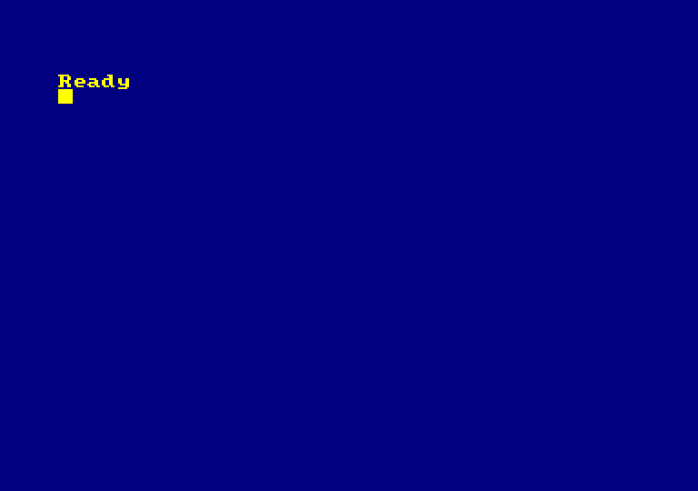

### 3.3 Full screen

Full screen can be achieved with the following CRTC configuration:

```basic
OUT &BC00, 2:OUT &BD00, 51:'Horizontal sync
OUT &BC00, 1:OUT &BD00, 50:'Horizontal width
OUT &BC00, 7:OUT &BD00, 35:'Vertical sync
OUT &BC00, 6:OUT &BD00, 33:'Vertical displayed
```

However this is not practically useful since the memory range CRTC can address is is limited 16K, but the screen size now requires more than that. For this we need to set R12 to `&1C`, which will make the video bank range from `&8000` to `&FFFF`.
