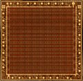
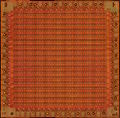
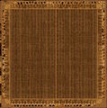

Отлично — теперь у меня есть полный HTML страницы, и я могу восстановить **весь английский текст в Markdown** с корректными ссылками на изображения. Ниже — полная реконструкция.

**Важно про картинки:** в HTML указаны локальные имена файлов (например `300px-Amstrad_40007_Gate_Array_xYlc.png`), но реальные URL на CPCWiki — это `https://www.cpcwiki.eu/images/...`. Я использую канонические ссылки на страницы файлов и прямые URL изображений, где они очевидны. Если какие-то пути не совпадут, замени префикс на актуальный.

---

# Gate Array

*Also designated as Video Gate Array (VGA, not to be confused with the IBM PC compatible graphic card spec).*


## Introduction

The Gate Array is a specially designed chip exclusively for use in the Amstrad CPC and was designed by Amstrad plc.

In the CPC+ system, the functions of the Gate Array are integrated into a single [ASIC](https://www.cpcwiki.eu/index.php/ASIC). When the ASIC is "locked", the extra features are not available and the ASIC operates the same as the Gate Array in the CPC allowing programs written for the CPC to work on the Plus without modification. The ASIC must be "un-locked" to access the new features.

In the [KC Compact](https://www.cpcwiki.eu/index.php/KC_Compact) system, the functions of the Gate Array are "emulated" in TTL chips, [CIO](https://www.cpcwiki.eu/index.php/CIO_Overview), and its color translation EPROM.

In the "cost-down" version of the CPC6128, the functions of the Gate Array are integrated into an ASIC.

## What does it do?

The Gate Array is responsible for the display (colour palette, resolution, horizontal and vertical sync), bus arbitration, DRAM refresh, interrupt generation and memory arrangement.

## Bus arbitration

The Gate Array arbitrates access to the RAM between the CPU and the video hardware (CRTC and Gate-Array).

Every microsecond:

- The CRTC generates a memory address using it's MA and RA signal outputs. See the [CRTC](https://www.cpcwiki.eu/index.php/CRTC) wiki page to know how the motherboard wiring transforms these signals into the Video Memory Address (VMA).
- The Gate Array fetches 2 bytes for each address. /CPU_ADDR is a 1MHz signal. So these 2 bytes are fetched sequentially. They are not interleaved with Z80 access. These bytes are fetched even when the border is on as this is required for DRAM refresh.
- The video hardware is given priority so that the display is not disrupted.

The Gate-Array generates the "READY" signal which is connected to the "/WAIT" input signal of the CPU. This signal is used to stop the CPU accessing RAM while the video-hardware is accessing it.

In fact, the Gate Array allows the Z80 to access the RAM in only 1 out of every 4 cycles. As a result, all instruction timings are stretched so that they are all multiples of a microsecond (1µs), and this gives an effective CPU clock of 3.3Mhz.

Unlike the ZX Spectrum or the Amiga, where bus arbitration is restricted to the "contended memory" or "chip RAM", on the CPC it also applies to ROM access and to RAM expansions. So the Z80 always runs at the same speed, regardless of the type of memory being accessed.

Last but not least, bus arbitration also applies to I/O access. And memory access is not aligned with I/O access on Z80.

*Note: On Amstrad Plus, the ASIC also has to handle DMA instruction fetch from RAM.*

## DRAM refresh

On Amstrad CPC, the Gate Array is responsible for the DRAM refresh, instead of using the Z80 built-in DRAM refresh mechanism. The reason is that there can only be 3 DRAM accesses per microsecond on this architecture. Doing DRAM refresh on each M1 cycle as it is done on MSX would bog down the CPU speed on CPC given its bus arbitration scheme.

The Z80 generates a maximum of one request per microsecond. The CPC also requires two memory accesses per microsecond for reading video data.

The CPC specs 4164-20 DRAMs. These require 330nS for a read or write cycle. The CPC also uses the optimised sequential CAS cycles to read the two video data bytes in half a microsecond. [Source](https://www.cpcwiki.eu/forum/amstrad-cpc-hardware/the-cpc-revision-zero-article/msg243769/)

The way to cause the RAM refresh to fail in both a Plus or normal CPC is simply to stop a few bits of the CRTC address changing (ie. never refresh the selected area).

Generally, only the Row address needs to be cycled, so stopping MA0 through MA7 from changing, and stopping the CPU from reading those rows, will cause data to be lost, quite quickly (generally around 4ms). [Source](https://www.cpcwiki.eu/forum/amstrad-cpc-hardware/memory-refresh-plus/)

## Interrupt generation

*Source: [Grimware portal (Grim)](https://www.grimware.org/doku.php/documentations/devices/gatearray)*

The CPU maskable interrupts are generated by the Gate Array. This is done by using a 6bits internal counter and monitoring the HSync and VSync signals produced by the CRTC.

On every falling edge of the HSync signal, the Gate Array will increment the counter by one. When the counter reaches 52, the Gate Array raise the INT signal and reset the counter. With 50Hz PAL CRTC settings (one HSync every 64us) this will produce a 300Hz interrupt rate.

When the CPU acknowledge the interrupt (eg. it is going to jump to the interrupt vector), the Gate Array will reset bit5 of the counter, so the next interrupt can't occur closer than 32 HSync.

When a VSync occurs, the Gate Array will wait for two HSync and:

- If the counter >= 32 (bit5=1), then no interrupt request is issued and counter is reset to 0.
- If the counter < 32 (bit5=0), then an interrupt request is issued and counter is reset to 0.

This 2 HSync delay after a VSync is used to let the main program, executed by the CPU, enough time to sense the VSync (for synchronisation with the display, most likely) before an interrupt service routine is eventually executed.

So all the interrupt timings are mostly determined by the CRTC settings. Other than that, the internal interrupt counter can be cleared anytime by software using the Gate Array RMR register.

The falling edge of the HSync trigger the counter, therefore modifying the duration of the HSync with the CRTC Register 3 can delay the interrupt requests by a few microseconds. This can be used to adjust interrupt timings between CPC and Plus machines…

*Note: On Amstrad Plus, the interrupt management system is seriously beefed up. See the [ASIC](https://www.cpcwiki.eu/index.php/ASIC) wiki page.*

### Timings

*Source: [Grimware portal (Grim)](https://www.grimware.org/doku.php/documentations/devices/gatearray)*

The INT signal (active low) produced by the Gate Array, is a short pulse of 1.4us and starts right after the falling edge of the HSync signal (produced by the CRTC).

### DI in peace

*Source: [Amslive No4 (Madram)](https://acpc.me/ACME/FANZINES)*

The GA maintains its int request until it is accepted.
RST #38 occurs not after the EI, but after the instruction following the EI (the Z80 needs time to clean up its act). Even if the int isn't validated by the Z80, IC (interrupt counter) continues on its merry way.
But after the EI, a test similar to the one seen for the VBL is performed:
The interrupt is generated anyway, but:

- If IC < 32, IC is unchanged (the next int will then be produced 21 to 52 lines later).
- Otherwise bit 5 of IC is set to zero.

## Controlling the Gate Array

The gate array is controlled by I/O. The gate array is selected when bit 15 of the I/O port address is set to "0" and bit 14 of the I/O port address is set to "1". The values of the other bits are ignored. However, to avoid conflict with other devices in the system, these bits should be set to "1".

The recommended I/O port address is `&7Fxx`.

The Gate Array is not connected to the CPU's RD and WR pins, so it cannot detect the bus's I/O direction. If you execute an I/O read operation on the Gate Array I/O address, the Gate Array will read an unpredictable value from the databus which will be in high-impedance state. If the value is a valid Gate Array command, it will be executed, otherwise nothing will happen. [Source](https://www.grimware.org/doku.php/documentations/devices/gatearray)

The function to be performed is selected by writing data to the Gate Array, the first bits of the data define the function selected (see table below). It is not possible to read from the Gate Array.

| 7 | 6 | 5 | 4..0 | Machine | Register | Description | Chip |
|---|---|-----|------|---------|----------|-------------|------|
| 0 | 0 | x | n | All | PENR | Select a color register | Gate Array |
| 0 | 1 | x | n | All | INKR | Change the value of the currently selected color register | Gate Array |
| 1 | 0 | 0 | n | All | RMR | Control Interrupt counter, ROM mapping and Graphics mode | Gate Array |
| 1 | 0 | 1 | n | All | RMR | *Ghost register* | Gate Array (CPC) or locked ASIC (Plus) |
| 1 | 0 | 1 | n | Plus | RMR2 | ASIC & Advanced ROM mapping | Unlocked ASIC |
| 1 | 1 | n | n | All | MMR | RAM memory mapping | PAL (only with 128KB or RAM expansion) |

The MMR register is not available in the Gate Array, but is performed by a device at the same I/O port address location.

In the CPC464, CPC664 and KC compact, MMR is performed in an external memory expansion (e.g. Dk'Tronics 64K RAM Expansion), if this expansion is not present then MMR is not available.

In the CPC6128, MMR is performed by a [PAL chip](https://www.cpcwiki.eu/index.php/PAL16L8) located on the main PCB, or an external memory expansion.

In the 464+ and 6128+, MMR is performed by the ASIC or an external memory expansion. Please read the document on RAM management for more information.

## Registers

*Note: The Plus palette capabilities are only accessible through the [ASIC I/O page](https://www.cpcwiki.eu/index.php/Default_I/O_Port_Summary). Registers PENR and INKR are not needed in that case.*

### Register PENR (Select a color register)

When bit 7 and bit 6 are set to "0", the remaining bits determine which pen is to have its colour changed. When bit 4 is set to "0", bits 3 to 0 define which pen is to be selected. When bit 4 is set to "1", the value contained in bits 3-0 is ignored and the border is selected.

The pen remains selected until another is chosen.

Each mode has a fixed number of pens. Mode 0 has 16 pens, mode 1 has 4 pens and mode 2 has 2 pens.

#### Summary

| Bit | Value | Function |
|-----|-------|----------|
| 7 | 0 | Gate Array PENR register |
| 6 | 0 | |
| 5 | - | not used |
| 4 | 1 | Select border |
| 3 | x | Ignored |
| 2 | x | |
| 1 | x | |
| 0 | x | |

| Bit | Value | Function |
|-----|-------|----------|
| 7 | 0 | Gate Array PENR register |
| 6 | 0 | |
| 5 | - | not used |
| 4 | 0 | Select pen |
| 3 | x | Pen number |
| 2 | x | |
| 1 | x | |
| 0 | x | |

### Register INKR (Change the value of the currently selected color register)

Once the pen has been selected its colour can then be changed. Bits 4 to 0 specify the hardware colour number from the hardware colour palette.

Even though there is provision for 32 colours, only 27 are possible. The remaining colours are duplicates of those already in the colour palette.

#### Summary

| Bit | Value | Function |
|-----|-------|----------|
| 7 | 0 | Gate Array INKR register |
| 6 | 1 | |
| 5 | - | not used |
| 4 | x | Colour number x |
| 3 | x | |
| 2 | x | |
| 1 | x | |
| 0 | x | |

### Register RMR (Control Interrupt counter, ROM mapping and Graphics mode)

This is a general purpose register responsible for the [graphics mode](https://www.cpcwiki.eu/index.php/Video_modes) and the ROM configuration.

#### Graphics mode selection

The function of bits 1 and 0 is to define the screen mode. The settings for bits 1 and 0 and the corresponding screen mode are given in the table below.

| Bit 1 | Bit 0 | Screen mode |
|-------|-------|-------------|
| 0 | 0 | Mode 0, 160x200 resolution, 16 colours |
| 0 | 1 | Mode 1, 320x200 resolution, 4 colours |
| 1 | 0 | Mode 2, 640x200 resolution, 2 colours |
| 1 | 1 | Mode 3, 160x200 resolution, 4 colours (undocumented) |

- Mode 3 is not official. From the combinations possible, we can see that 4 modes can be defined, although the Amstrad only has 3. Mode 3 is similar to mode 0, because it has the same resolution, but it is limited to only 4 colours. Mode 3 is not supported by the [KC Compact](https://www.cpcwiki.eu/index.php/KC_Compact) (which outputs black in Mode 3).

Mode changing is synchronised with HSYNC. If the mode is changed, it will take effect from the next HSYNC.

#### ROM configuration selection

Bit 2 is used to enable or disable the lower ROM area. The lower ROM area occupies memory addresses `&0000-&3fff` and is used to access the operating system ROM. When the lower ROM area is enabled, reading from `&0000-&3FFF` will return data in the ROM. When a value is written to `&0000-&3FFF`, it will be written to the RAM underneath the ROM. When it is disabled, data read from `&0000-&3FFF` will return the data in the RAM.

Similarly, bit 3 controls enabling or disabling of the upper ROM area. The upper ROM area occupies memory addresses `&C000-&FFFF` and is BASIC or any expansion ROMs which may be plugged into a ROM board/box. See the document on [upper rom selection](https://www.cpcwiki.eu/index.php/Upper_ROM_Bank_Number) for more details. When the upper ROM area enabled, reading from `&c000-&ffff`, will return data in the ROM. When data is written to `&c000-&FFFF`, it will be written to the RAM at the same address as the ROM. When the upper ROM area is disabled, and data is read from `&c000-&ffff` it will be the data in the RAM.

Bit 4 controls the interrupt generation. It can be used to delay interrupts. See the document on interrupt generation for more information.

#### Summary

| Bit | Value | Function |
|-----|-------|----------|
| 7 | 1 | Gate Array RMR register |
| 6 | 0 | |
| 5 | - | *must be 0 on Plus machines with ASIC unlocked* |
| 4 | x | Interrupt generation control |
| 3 | x | 1=Upper ROM area disable, 0=Upper ROM area enable |
| 2 | x | 1=Lower ROM area disable, 0=Lower ROM area enable |
| 1 | x | Graphics Mode selection |
| 0 | x | |

### Register RMR2 (ASIC & Advanced ROM mapping)

This register exists only in Plus or GX4000, and is only accessible when the ASIC is unlocked.

| Bit | Value | Function |
|-----|-------|----------|
| 7 | 1 | Gate Array RMR2 register |
| 6 | 0 | |
| 5 | 1 | |
| 4 | x | RMR addressing mode |
| 3 | x | |
| 2 | x | Physical ROM number (0..7) |
| 1 | x | |
| 0 | x | |

**RMR addressing modes**

| Bit 4 | Bit 3 | Lower ROM | ASIC I/O page |
|-------|-------|-----------|---------------|
| 0 | 0 | &0000-&3FFF | Disabled |
| 0 | 1 | &4000-&7FFF | Disabled |
| 1 | 0 | &8000-&BFFF | Disabled |
| 1 | 1 | &0000-&3FFF | &4000-&7FFF |

The physical ROMs are also accessible as upper ROMs by using the [Upper ROM Bank Number](https://www.cpcwiki.eu/index.php/Upper_ROM_Bank_Number) port and the RMR register.

### Register MMR (RAM memory mapping)

This register exists only in CPCs with 128K RAM (like the CPC 6128), or CPCs equipped with [Standard Memory Expansions](https://www.cpcwiki.eu/index.php/Standard_Memory_Expansions).

*Note: In the CPC 6128, the register is a separate [PAL chip](https://www.cpcwiki.eu/index.php/PAL16L8) that assists the Gate Array chip.*

| Bit | Value | Function |
|-----|-------|----------|
| 7 | 1 | Gate Array MMR register |
| 6 | 1 | |
| 5 | x | 64K bank number (0..7); always 0 on an unexpanded CPC6128, 0-7 on [Standard Memory Expansions](https://www.cpcwiki.eu/index.php/Standard_Memory_Expansions) |
| 4 | x | |
| 3 | x | |
| 2 | x | RAM Config (0..7) |
| 1 | x | |
| 0 | x | |

The 3bit RAM Config value is used to access the second 64K of the total 128K RAM that is built into the CPC 6128 or the additional 64K-512K of standard memory expansions. These contain up to eight 64K ram banks, which are selected with bit 3-5. A standard CPC 6128 only contains bank 0. Normally the register is set to 0, so that only the first 64K RAM are used (identical to the CPC 464 and 664 models). The register can be used to select between the following eight predefined configurations only:

```
 -Address-     0      1      2      3      4      5      6      7
 0000-3FFF   RAM_0  RAM_0  RAM_4  RAM_0  RAM_0  RAM_0  RAM_0  RAM_0
 4000-7FFF   RAM_1  RAM_1  RAM_5  RAM_3  RAM_4  RAM_5  RAM_6  RAM_7
 8000-BFFF   RAM_2  RAM_2  RAM_6  RAM_2  RAM_2  RAM_2  RAM_2  RAM_2
 C000-FFFF   RAM_3  RAM_7  RAM_7  RAM_7  RAM_3  RAM_3  RAM_3  RAM_3
```

The Video RAM is always located in the first 64K, VRAM is in no way affected by this register.

## Programming the Gate Array - Examples

Defining the colours, Setting pen 0 to Bright White.

```asm
LD BC,7F00    ;Gate Array port
LD A,%00000000+0  ;Pen number (and Gate Array function)
OUT (C),A     ;Send pen number
LD A,%01000000+11 ;Pen colour (and Gate Array function)
OUT (C),A     ;Send it
RET
```

Setting the mode and ROM configuration, Mode 2, upper and lower ROM disabled.

```asm
LD BC,7F00    ;Gate array port
LD A,%10000000+%00001110  ;Mode and ROM selection (and Gate Array function)
OUT (C),A     ;Send it
RET
```

### Misc

The hardware colour number is different to the colour range used by the firmware, so a conversion chart is provided for the corresponding firmware/hardware colour values and the corresponding colour name.

### Note

The firmware keeps track of the colours it is using. Every VSYNC (assuming interrupts are enabled) the firmware sets the colours. This enables the user to have flashing colours. If the user selects a new colour using the gate array, the new colour will flash temporarily and then return to its original colour. This is due to the firmware resetting the colour. When using the firmware, use its routines to select the colour, and the colour will remain.

Example: [For whatever reason, this example does NOT refer to the above firmware stuff]

```asm
ld bc,7f00+1  ;Gate array function (set pen)
;and pen number
out (c),c
ld bc,7f00    ;41 
;Gate array function (set colour)
;and colour number
out (c),c
ret
```

## Video memory structure

| Graphics Mode | 7 | 6 | 5 | 4 | 3 | 2 | 1 | 0 | 1 | 2 | 3 | 4 | 5 | 6 | 7 | 8 | Definition | Pixel clock | Default resolution |
|---------------|---|---|---|---|---|---|---|---|---|---|---|---|---|---|---|---|------------|-------------|--------------------|
| 0 | A0 | B0 | A2 | B2 | A1 | B1 | A3 | B3 | **A** | **A** | **A** | **A** | **B** | **B** | **B** | **B** | 2 pixels in 16 colours | 4 MHz | 160x200, 20-column text |
| 1 | A0 | B0 | C0 | D0 | A1 | B1 | C1 | D1 | **A** | **A** | **B** | **B** | **C** | **C** | **D** | **D** | 4 pixels in 4 colours | 8 MHz | 320x200, 40-column text |
| 2 | A0 | B0 | C0 | D0 | E0 | F0 | G0 | H0 | A | B | C | D | E | F | G | H | 8 pixels in 2 colours | 16 MHz | 640x200, 80-column text |
| 3 | A0 | B0 | x | x | A1 | B1 | x | x | **A** | **A** | **A** | **A** | **B** | **B** | **B** | **B** | 2 pixels in 4 colours | 4 MHz | 160x200, 20-column text |

## Split rasters

On the CPC, split rasters occur halfway (after the 8th mode2 pixel) through the rendering of a CRTC character.

On Amstrad Plus, split rasters occur quarter of the way (after the 4th mode2 pixel) through the rendering of a CRTC character.

To easily make split rasters compatible with both the CPC and the Plus machines, one can use the ASIC soft-scroll control register (SSCR) to finely adjust the horizontal position of the graphics.

## Palette R,G,B definitions

There are 27 colours which are generated from red, green and blue mixed in different quantities. There are 3 levels of red, 3 levels of green and 3 levels of blue, and these can be thought of as off/no colour, half-on/half-colour, and on/full-colour.

To display a CPC image you will need to use a analogue monitor with a composite sync.

### Palette sorted by Firmware Colour Numbers

The firmware colour palette is sorted by luminance value.

| Firmware Number | Hardware Number | Colour Name | R % | G % | B % | ASIC | Colour |
|-----------------|-----------------|-------------|-----|-----|-----|------|--------|
| 0 | 54h | Black | 0 | 0 | 0 | #000 | ⬛ |
| 1 | 44h (or 50h) | Blue | 0 | 0 | 50 | #006 | 🟦 |
| 2 | 55h | Bright Blue | 0 | 0 | 100 | #00F | 🟦 |
| 3 | 5Ch | Red | 50 | 0 | 0 | #600 | 🟥 |
| 4 | 58h | Magenta | 50 | 0 | 50 | #606 | 🟪 |
| 5 | 5Dh | Mauve | 50 | 0 | 100 | #60F | 🟪 |
| 6 | 4Ch | Bright Red | 100 | 0 | 0 | #F00 | 🟥 |
| 7 | 45h (or 48h) | Purple | 100 | 0 | 50 | #F06 | 🟪 |
| 8 | 4Dh | Bright Magenta | 100 | 0 | 100 | #F0F | 🟪 |
| 9 | 56h | Green | 0 | 50 | 0 | #060 | 🟩 |
| 10 | 46h | Cyan | 0 | 50 | 50 | #066 | 🟦 |
| 11 | 57h | Sky Blue | 0 | 50 | 100 | #06F | 🟦 |
| 12 | 5Eh | Yellow | 50 | 50 | 0 | #660 | 🟨 |
| 13 | 40h (or 41h) | White | 50 | 50 | 50 | #666 | ⬜ |
| 14 | 5Fh | Pastel Blue | 50 | 50 | 100 | #66F | 🟦 |
| 15 | 4Eh | Orange | 100 | 50 | 0 | #F60 | 🟧 |
| 16 | 47h | Pink | 100 | 50 | 50 | #F66 | 🟪 |
| 17 | 4Fh | Pastel Magenta | 100 | 50 | 100 | #F6F | 🟪 |
| 18 | 52h | Bright Green | 0 | 100 | 0 | #0F0 | 🟩 |
| 19 | 42h (or 51h) | Sea Green | 0 | 100 | 50 | #0F6 | 🟩 |
| 20 | 53h | Bright Cyan | 0 | 100 | 100 | #0FF | 🟦 |
| 21 | 5Ah | Lime | 50 | 100 | 0 | #6F0 | 🟩 |
| 22 | 59h | Pastel Green | 50 | 100 | 50 | #6F6 | 🟩 |
| 23 | 5Bh | Pastel Cyan | 50 | 100 | 100 | #6FF | 🟦 |
| 24 | 4Ah | Bright Yellow | 100 | 100 | 0 | #FF0 | 🟨 |
| 25 | 43h (or 49h) | Pastel Yellow | 100 | 100 | 50 | #FF6 | 🟨 |
| 26 | 4Bh | Bright White | 100 | 100 | 100 | #FFF | ⬜ |

*Note: We can observe that the official Amstrad names of some colours are a bit silly: "red" is in fact brown, "yellow" is in fact khaki and "white" is in fact grey.*

### Amstrad Colour Names


### Palette sorted by Hardware Colour Numbers

| Hardware Number | Firmware Number | R % | G % | B % | ASIC | Colour | Colour Name | German Name | French Name | Spanish Name |
|-----------------|-----------------|-----|-----|-----|------|--------|-------------|-------------|-------------|--------------|
| 0 (40h) | 13 | 50 | 50 | 50 | #666 | ⬜ | White | Weiß | Blanc | Blanco |
| 1 (41h) | (13) | 50 | 50 | 50 | #666 | ⬜ | White | Weiß | Blanc | Blanco |
| 2 (42h) | 19 | 0 | 100 | 50 | #0F6 | 🟩 | Sea Green | Seegrün | Vert marin | Verde marino |
| 3 (43h) | 25 | 100 | 100 | 50 | #FF6 | 🟨 | Pastel Yellow | Pastellgelb | Jaune pastel | Amarillo pastel |
| 4 (44h) | 1 | 0 | 0 | 50 | #006 | 🟦 | Blue | Blau | Bleu | Azul |
| 5 (45h) | 7 | 100 | 0 | 50 | #F06 | 🟪 | Purple | Purpur | Pourpre | Púrpura |
| 6 (46h) | 10 | 0 | 50 | 50 | #066 | 🟦 | Cyan | Blaugrün | Turquoise | Ciano |
| 7 (47h) | 16 | 100 | 50 | 50 | #F66 | 🟪 | Pink | Rosa | Rose | Rosa |
| 8 (48h) | (7) | 100 | 0 | 50 | #F06 | 🟪 | Purple | Purpur | Pourpre | Púrpura |
| 9 (49h) | (25) | 100 | 100 | 50 | #FF6 | 🟨 | Pastel Yellow | Pastellgelb | Jaune pastel | Amarillo pastel |
| 10 (4Ah) | 24 | 100 | 100 | 0 | #FF0 | 🟨 | Bright Yellow | Hellgelb | Jaune vif | Amarillo brillante |
| 11 (4Bh) | 26 | 100 | 100 | 100 | #FFF | ⬜ | Bright White | Leuchtendweiß | Blanc brillant | Blanco brillante |
| 12 (4Ch) | 6 | 100 | 0 | 0 | #F00 | 🟥 | Bright Red | Hellrot | Rouge vif | Rojo brillante |
| 13 (4Dh) | 8 | 100 | 0 | 100 | #F0F | 🟪 | Bright Magenta | helles Magenta | Magenta vif | Magenta brillante |
| 14 (4Eh) | 15 | 100 | 50 | 0 | #F60 | 🟧 | Orange | Orange | Orange | Naranja |
| 15 (4Fh) | 17 | 100 | 50 | 100 | #F6F | 🟪 | Pastel Magenta | Pastell-magenta | Magenta pastel | Magenta pastel |
| 16 (50h) | (1) | 0 | 0 | 50 | #006 | 🟦 | Blue | Blau | Bleu | Azul |
| 17 (51h) | (19) | 0 | 100 | 50 | #0F6 | 🟩 | Sea Green | Seegrün | Vert marin | Verde marino |
| 18 (52h) | 18 | 0 | 100 | 0 | #0F0 | 🟩 | Bright Green | Hellgrün | Vert vif | Verde brillante |
| 19 (53h) | 20 | 0 | 100 | 100 | #0FF | 🟦 | Bright Cyan | helles Blaugrün | Turquoise vif | Ciano brillante |
| 20 (54h) | 0 | 0 | 0 | 0 | #000 | ⬛ | Black | Schwarz | Noir | Negro |
| 21 (55h) | 2 | 0 | 0 | 100 | #00F | 🟦 | Bright Blue | Hellblau | Bleu vif | Azul brillante |
| 22 (56h) | 9 | 0 | 50 | 0 | #060 | 🟩 | Green | Grün | Vert | Verde |
| 23 (57h) | 11 | 0 | 50 | 100 | #06F | 🟦 | Sky Blue | Himmelblau | Bleu ciel | Azul cielo |
| 24 (58h) | 4 | 50 | 0 | 50 | #606 | 🟪 | Magenta | Magenta | Magenta | Magenta |
| 25 (59h) | 22 | 50 | 100 | 50 | #6F6 | 🟩 | Pastel Green | Pastellgrün | Vert pastel | Verde pastel |
| 26 (5Ah) | 21 | 50 | 100 | 0 | #6F0 | 🟩 | Lime | Limonengrün | Vert citron | Verde lima |
| 27 (5Bh) | 23 | 50 | 100 | 100 | #6FF | 🟦 | Pastel Cyan | Pastell-blaugrün | Turquoise pastel | Ciano pastel |
| 28 (5Ch) | 3 | 50 | 0 | 0 | #600 | 🟥 | Red | Rot | Rouge | Rojo |
| 29 (5Dh) | 5 | 50 | 0 | 100 | #60F | 🟪 | Mauve | Hellviolett | Mauve | Malva |
| 30 (5Eh) | 12 | 50 | 50 | 0 | #660 | 🟨 | Yellow | Gelb | Jaune | Amarillo |
| 31 (5Fh) | 14 | 50 | 50 | 100 | #66F | 🟦 | Pastel Blue | Pastellblau | Bleu pastel | Azul pastel |

*Примечание переводчика: в оригинале для каждого цвета есть цветной квадратик (`bgcolor`), здесь заменён на эмодзи-индикатор, чтобы сохранить таблицу в Markdown без поломки разметки. Для точных цветов используйте значения ASIC (#XXX) или таблицу палитры из генератора.*

### Intensities

The 0%, 50%, and 100% values in the above tables are "should-be" values. However, the real hardware doesn't exactly match that intensities. The actual intensities depend on the luminance mixing (R,G,B tied together via resistors), on chipset (classic CPC, or newer ASIC ones), and on the load applied by external hardware (Monitor, or TV set).

On an actual Amstrad CPC, the half-intensity colour signal is measured to be closer to 40% rather than the expected 50%. This was verified by [Grim](https://www.cpcwiki.eu/index.php/Grim) and independently confirmed by [Nocash](https://www.cpcwiki.eu/index.php/Nocash). [Source](https://www.grimware.org/doku.php/documentations/devices/gatearray#inkr)

- [CPC Palette](https://www.cpcwiki.eu/index.php/CPC_Palette) - some more details

This explains why the Amstrad engineers used the following values to adapt the old colour palette to the new 12-bit palette on the Amstrad Plus:

- 0% became #0
- 50% became #6. They specifically chose #6 for the 50% value instead of the expected #7 or #8, to better match the real Amstrad CPC palette.
- 100% became #F

### Green Screen Colours

On a green screen, where all colours are shades of unsaturated green, the firmware colours are in order of increasing intensity. Black is darkest green, bright white is brightest green, and firmware colour 13 is a medium green.

The luminance (Y) is not exactly correlated to the actual luminance of colour images broadcast in RGB. Amstrad preferred to propose a completely different image system, not comparable to a conversion to monochrome, which would have limited the number of brightness levels to 21 (for example, colours 9 and 6 would have had the same luminance).

They opted for a table of 27 linear brightness steps. They assigned values of 1 (1kΩ) for blue, 3 (3.3kΩ) for red, and 9 (10kΩ) for green.

#### To calculate the luminance value

**Red**
- 0% => do not add anything
- 50% => add 3
- 100% => add 6

**Green**
- 0% => do not add anything
- 50% => add 9
- 100% => add 18

**Blue**
- 0% => do not add anything
- 50% => add 1
- 100% => add 2

## Pictures
<table><tr><td>


*40010 GA Metal Layer*

</td><td>


*40010 GA with Metal Layer removed*

</td><td>


*40226 PreASIC Metal Layer*

</td></tr></table>
<table><tr><td>


*Gate Array pinout 40007*

</td><td>


*Gate Array pinout 40008/40010*

</td></tr></table>

*Note: Some CPC motherboards can accommodate both types of Gate Array pinouts. [Source](https://thecheshirec.at/2024/10/06/il-existe-une-carte-multi-gate-array-et-cest-amstrad-qui-la-faite/)*

## External links

- [Electronic signals analysis of the Gate Array by Bread80](https://bread80.com/2021/06/03/understanding-the-amstrad-cpc-video-ram-and-gate-array-subsystem/)
- [Gate Array documentation in Amstrad CRTC Compendium](https://shaker.logonsystem.eu/ACCC1.8-EN.pdf)
- [Gate Array documentation from Grimware](https://www.grimware.org/doku.php/documentations/devices/gatearray)
- [Quasar Gate Array documentation (in french)](http://quasar.cpcscene.net/doku.php?id=assem:gate_array)

## See also

- [Gate Array and ASIC Pin-Outs](https://www.cpcwiki.eu/index.php/Gate_Array_and_ASIC_Pin-Outs)
- [PAL16L8](https://www.cpcwiki.eu/index.php/PAL16L8) : for RAM arrangement
- [ASIC](https://www.cpcwiki.eu/index.php/ASIC) : for Plus users
- [CRTC](https://www.cpcwiki.eu/index.php/CRTC) : the other video stuff
- [Synchronising with the CRTC and display](https://www.cpcwiki.eu/index.php/Synchronising_with_the_CRTC_and_display) : technical details on the relationship between Gate Array and CRTC.
- [Video modes](https://www.cpcwiki.eu/index.php/Video_modes) : for other informations on colours and pixels.
- [Media:40010-simplified V03.pdf](https://www.cpcwiki.eu/imgs/b/b1/40010-simplified_V03.pdf) [Forum thread](https://www.cpcwiki.eu/forum/amstrad-cpc-hardware/gate-array-decapped!/msg170713/#msg170713) Gate Array schematics - reverse engineered by Gerald

