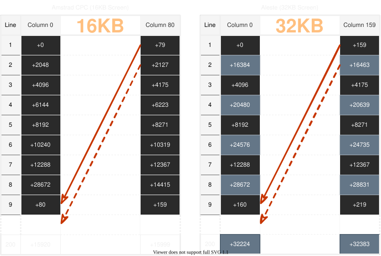

# 03. Экран

Экран — самая заметная часть любой программы, и в CPC с ней
связано больше всего неприятных сюрпризов. Главный из них —
видеопамять адресуется не так, как ты ожидаешь. Не линейно.
Пиксель за пикселем, строка за строкой — так не получится.

В этом разделе мы разберёмся, почему так, и как с этим жить.
А ещё — режимы экрана, палитра, CRTC, memory contention,
латентность видеоконвейера, скроллинг и как вывести
первый пиксель.

## Видеочип: MC6845

В Aleste, как и в CPC, стоит микросхема MC6845 — контроллер
электронно-лучевой трубки. Она управляет развёрткой и генерацией
адресов видеопамяти. Программист может настраивать её через
регистры, но для большинства задач это не нужно: BIOS уже
выставил стандартные значения.

Порты CRTC:

| Порт    | Что делает      | R/W |
|---------|-----------------|-----|
| `#BCXX` | Номер регистра  | W   |
| `#BDXX` | Данные (запись) | W   |
| `#BEXX` | Статус          | R   |
| `#BFXX` | Данные (чтение) | R   |

Чтобы записать значение в регистр CRTC, сначала пишешь номер
регистра в `#BCXX`, потом значение в `#BDXX`.

```
LD A, 1            ; регистр 1 (ширина видимой области)
OUT (#BCXX), A
LD A, 40           ; 40 символов в строке
OUT (#BDXX), A
```

Для чтения — то же самое, но данные читаешь из `#BFXX`.

Пример на BASIC — если хочешь поэкспериментировать
без ассемблера:

```
OUT &BC00, 1: OUT &BD00, 42
```

Это устанавливает регистр 1 в значение 42.

## Регистры CRTC

У CRTC 16 программируемых регистров. Вот они с дефолтными
значениями (для стандартного экрана CPC):

| Регистр | Имя                                 | Дефолт |
|---------|-------------------------------------|--------|
| 0       | Horizontal Total                    | 63     |
| 1       | Horizontal Displayed                | 40     |
| 2       | Horizontal Sync Position            | 46     |
| 3       | Horizontal and Vertical Sync Widths | 128+14 |
| 4       | Vertical Total                      | 38     |
| 5       | Vertical Total Adjust               | 0      |
| 6       | Vertical Displayed                  | 25     |
| 7       | Vertical Sync Position              | 30     |
| 8       | Interlace and Skew                  | 0      |
| 9       | Maximum Raster Address              | 7      |
| 10      | Cursor Start Raster                 | 0      |
| 11      | Cursor End Raster                   | 0      |
| 12      | Display Start Address (High)        | 48     |
| 13      | Display Start Address (Low)         | 0      |
| 14      | Cursor Address (High)               | 0      |
| 15      | Cursor Address (Low)                | 0      |
| 16      | Light Pen Address (High)            | 0      |
| 17      | Light Pen Address (Low)             | 0      |

С этими значениями экран имеет 40 символов в ширину и 25 в высоту, что даёт 1000 символов. Каждый символ занимает 2 байта в режиме 1, так что весь экран — это 2000 байт по адресам 0xC000–0xC7FF.

Важно: CRTC прыгает на 2048 байт (0x800) на каждую следующую строку символа. Это значит, что 40×25 символов занимают не 2000 байт подряд, а 2048 байт на строку. Лишние 48 байт на строку не видны на статичном экране, но становятся видны при скроллинге. Итого 8 × 48 = 384 байта «невидимой» видеопамяти.

## Режимы экрана

У Aleste пять графических режимов. И дополнительный бит **HIGHX** для изменения скорости доступа в видеопамятью Когда **HIGHX** равен 0 то все работает как у стандартного Amstrad CPC, размер буфера 16КБ, а количество цветов меняется регистром **RMR**, два младших бита которого определяют режим графики

### RMR регистр конфигурации ROM и режима графики

Регистр RMR находится по адресу `#7F00` но для записи в него два старших бита данных должны быть в состоянии 10.
Этот регистр имеет большой функционал: он отвечает за режим графики и светодиоды клавиатуры, однако сейчас главное — изучить биты управления графикой.

| Bits | Value | Function                                                      |
|------|-------|---------------------------------------------------------------|
| 7,6  | 1,0   | Константа выбора RMR регистра                                 |
| 5    | -     | CAPS LED                                                      |
| 4    | x     | RUS LED                                                       |
| 3    | x     | 1=Upper ROM area disable, 0=Upper ROM area enable             |
| 2    | x     | 1=Lower ROM area disable, 0=Lower ROM area enable             |
| 1,0  | x     | Graphics Mode selection                                       |

Режим графики определяется двумя младшими битами, которые позволяют выбрать один из 3х режимов экрана.

**Таблица** режимов 16КБ

| Режим | Разрешение      | Цветов | Память | Символов в строке |
|-------|-----------------|--------|--------|-------------------|
| 0     | 160×200         | 16     | 16 КБ  | 20                |
| 1     | 320×200         | 4      | 16 КБ  | 40                |
| 2     | 640×200         | 2      | 16 КБ  | 80                |
| 3     | не используется |        |        |                   |

Однако, как уже было сказано выше, у Aleste есть специальный бит **HIGHX** высокое горизонтальное разрешение. Включив этот бит два режима меняют свои характеристики. Этот бит номер 1 который находится в регистре `Ext Port` по адресу #FABF. Включив этот бит повышается скорость доступа в память и удваивается размер видеобуфера. При этом понижается тактовая частота с 16МГц на 13.3МГц. Понижение частоты хотя и понижает производительность процессора, позволяет изменить пропорции пикселя ближе к пропорциям систем MSX. Так как именно это необходимое условие для симуляции игр MSX на Aleste.

**Таблица** режимов 32КБ

| Режим | Разрешение | Цветов | Память | Символов в строке |
|-------|------------|--------|--------|-------------------|
| 0     | 640×200    | 4      | 32 КБ  | 80                |
| 1     | 320×200    | 16     | 32 КБ  | 40                |

### Как выбрать режим

Режим выбирается через Gate Array #7Fxx при этом биты 7,6 должны быть 1 и 0 соответственно.

Проще говоря: чтобы получить 16 цветов при 320×200, нужно
включить HIGHX и выставить режим с 4 битами на пиксель.

```asm
; Внимание биты 7,6 = 10 означает запись в регистр RMR
; Код ниже оставляет режим ROM выключено
; Пишем данные: режим0
LD A, %10001100    ; биты 7,6 = 10 → регистр 2
OUT (#7FXX), A

; Пишем данные: режим 1
LD A, %10001101    ; включить режим 320x200 4 цвета
OUT (#7FXX), A
```

## Формат цвета пикселей

Формат цветовых пикселей меняет как количество пикселей в байте так и количество возможных цветов в пикселе -- иначе говоря количество бит на пиксель.

Как видно из способа перестановки битов:

- Каждый байт режима 2 содержит 8 пикселей по 1 биту (1 цвет).
- Каждый байт режима 1 содержит 4 пикселя по 2 бита (4 цвета).
- Каждый байт режима 0 содержит 2 пикселя по 4 бита (16 цветов).

### Табличное представление пикселей

```txt
+-----------+---------------------------------------+---------------------------------------------------------------------------------------+
|           |           Структура байта/пикселя     |                                                                                       |
|-----------+----+----+----+----+----+----+----+----+-------------------------------+-------------------------------------------------------|
| VM (Режим)| 7  | 6  | 5  | 4  | 3  | 2  | 1  | 0  | Отображение на экране         | Детали                                                |
|-----------+----+----+----+----+----+----+----+----+---------------+---------------+-------------------------------------------------------|
| %00 (0)   | A0 | B0 | A2 | B2 | A1 | B1 | A3 | B3 | A             | B             | 4 бита/пиксель (16 цветов), 2 пикселя/байт (160×200)  |
|-----------+----+----+----+----+----+----+----+----+-------+-------+-------+-------+-------------------------------------------------------|
| %01 (1)   | A0 | B0 | C0 | D0 | A1 | B1 | C1 | D1 | A     | B     | C     | D     | 2 бита/пиксель (4 цвета), 4 пикселя/байт (320×200)    |
|-----------+----+----+----+----+----+----+----+----+---+---+---+---+---+---+---+---+-------------------------------------------------------|
| %10 (2)   | A  | B  | C  | D  | E  | F  | G  | H  | A | B | C | D | E | F | G | H | 1 бит/пиксель (2 цвета), 8 пикселей/байт (640×200)    |
+-----------+----+----+----+----+----+----+----+----+---+---+---+---+---+---+---+---+-------------------------------------------------------+
```

Изображение ниже показывает как можно закодировать два, 4 или 16 цветов в разных режимах. Например в режиме 0, на левйо картинке мы видим два крупных пиксела: красный и оранжевый. На правой картинке то как биты этих пикселей расположены в байте. Аналогичная ситуация для других режимов.

<table><tr><td>


</td><td>


</td></tr></table>

### Макросы преобразования пикселей/чернил

Вот C-макросы для преобразования цвета в биты байта

```c
#define MODE_1_P0(c) (((c & 2) >> 1) << 3) | ((c & 1) << 7)
#define MODE_1_P1(c) (((c & 2) >> 1) << 2) | ((c & 1) << 6)
#define MODE_1_P2(c) (((c & 2) >> 1) << 1) | ((c & 1) << 5)
#define MODE_1_P3(c) (((c & 2) >> 1) << 0) | ((c & 1) << 4)

#define MODE_0_P0(c) ((c & 8) >> 2) | ((c & 4) << 3) | ((c & 2) << 2) | ((c & 1) << 7)
#define MODE_0_P1(c) ((c & 8) >> 3) | ((c & 4) << 2) | ((c & 2) << 1) | ((c & 1) << 6)
```

## Палитра цветов

Особенность работы палитры заключается в том что режим палитры переключается вместе в *MAPMOD*.

Когда MAPMOD = 0 (CPC-режим), палитра работает как в CPC: значение, которое ты пишешь, интерпретируется через таблицу и на выходе получаются 27 цветов.

Когда MAPMOD = 1 (Aleste-режим), значение интерпретируется напрямую как R,G,B с двумя битами на канал — и даёт 64 цвета.

На практике это значит: **один и тот же байт даст разный цвет в разных режимах**. Если переключаешь MAPMOD, будь готов перенастроить палитру.

Ещё: в CPC-режиме Aleste использует только «тёмные» уровни яркости (0%, 33%, 66%), потому что CPC-палитра рассчитана на три уровня. Из-за этого 64-цветный режим кажется ярче. Это нормально, просто учти при переключении.

## Палитра: 27 цвета

В Amstrad очень элегантная таблица цветов, она преобразует 5-ти битный номер в цвет. Ниже приведена таблица цветов.

| Номер цвета | Название цвета               | R % | G % | B % | Изображение                                               |
|-------------|------------------------------|-----|-----|-----|-----------------------------------------------------------|
| 0           | White                        | 50  | 50  | 50  |  |
| 1           | White (примечание 1)         | 50  | 50  | 50  |  |
| 2           | Sea Green                    | 0   | 100 | 50  |  |
| 3           | Pastel Yellow                | 50  | 50  | 0   |  |
| 4           | Blue                         | 0   | 0   | 50  |  |
| 5           | Purple                       | 100 | 0   | 50  |  |
| 6           | Cyan                         | 0   | 50  | 50  |  |
| 7           | Pink                         | 100 | 50  | 50  |  |
| 8           | Purple (примечание 1)        | 100 | 0   | 50  |  |
| 9           | Pastel Yellow (примечание 1) | 50  | 50  | 0   |  |
| 10          | Bright Yellow                | 100 | 100 | 0   |  |
| 11          | Bright White                 | 100 | 100 | 100 |  |
| 12          | Bright Red                   | 100 | 0   | 0   |  |
| 13          | Bright Magenta               | 100 | 0   | 100 |  |
| 14          | Orange                       | 100 | 50  | 0   |  |
| 15          | Pastel Magenta               | 100 | 50  | 100 |  |
| 16          | Blue (примечание 1)          | 0   | 0   | 50  |  |
| 17          | Sea Green (примечание 1)     | 0   | 100 | 50  |  |
| 18          | Bright Green                 | 0   | 100 | 0   |  |
| 19          | Bright Cyan                  | 0   | 100 | 100 |  |
| 20          | Black                        | 0   | 0   | 0   |  |
| 21          | Bright Blue                  | 0   | 0   | 100 |  |
| 22          | Green                        | 0   | 50  | 0   |  |
| 23          | Sky Blue                     | 0   | 50  | 100 |  |
| 24          | Magenta                      | 50  | 0   | 50  |  |
| 25          | Pastel Green                 | 50  | 100 | 0   |  |
| 26          | Lime                         | 50  | 100 | 0   |  |
| 27          | Pastel Cyan                  | 50  | 100 | 100 |  |
| 28          | Red                          | 50  | 0   | 0   |  |
| 29          | Mauve                        | 50  | 0   | 100 |  |
| 30          | Yellow                       | 50  | 50  | 0   |  |
| 31          | Pastel Blue                  | 50  | 50  | 100 |  |

**Примечания:** Это неофициальный цвет.

## Палитра: 64 цвета

Кода маппер включен *MAPMOD* == 1, то работает палитра на 64 цвета. Каждый цвет кодируется шестью битами -- по два бита на красный, зелёный и синий компоненты.

```txt
бит 5,4 — красный
бит 3,2 — зелёный
бит 1,0 — синий
```

Каждый компонент может принимать значения 0, 1, 2, 3. Это
даёт четыре уровня яркости на канал: 0%, 33%, 66%, 100%.

### Как записать цвет

Палитра управляется через Gate Array, регистры 0 и 1.

Сначала выбираешь индекс цвета (какой из 16 цветов палитры
меняешь), потом записываешь значение.

```asm
; Регистр 0 Gate Array: выбор индекса палитры
LD A, %00000000    ; биты 7,6 = 00 → регистр 0
OUT (#7FXX), A
LD A, 4            ; индекс 4 (пятый цвет палитры)
OUT (#7FXX), A

; Регистр 1 Gate Array: данные палитры
LD A, %01000000    ; биты 7,6 = 01 → регистр 1
OUT (#7FXX), A
LD A, %00100010    ; цвет: красный = 2, зелёный = 0, синий = 2
OUT (#7FXX), A     ; получился фиолетовый
```

Индексы 0–15 — это цвета для пикселей. Индекс 16 (0x10) —
цвет бордюра. Индексы 17–31 дают тот же бордюр.

## Адресация видеопамяти: самое важное

А вот теперь — то, из-за чего многие бросают программировать
на CPC. Видеопамять адресуется **не линейно**. Строки идут
не подряд.

Причина историческая: MC6845 разрабатывался для текстовых
терминалов, и адресация оптимизирована под символьные строки,
а не под линейный растр.

Что это значит на практике. В обычном компьютере адрес пикселя
вычисляется так: `база + y * ширина + x`. В CPC — иначе.
Строки группируются в блоки по 8, и внутри блока строки идут
с шагом 0x800 (2048 байт). А между блоками — с шагом 0x50
(80 байт).

Вот карта для режимов с 16 КБ буфером:

```txt
Строка 0:    адрес A + 0
Строка 1:    адрес A + 2048
Строка 2:    адрес A + 4096
Строка 3:    адрес A + 6144
Строка 4:    адрес A + 8192
Строка 5:    адрес A + 10240
Строка 6:    адрес A + 12288
Строка 7:    адрес A + 14336
Строка 8:    адрес A + 80
Строка 9:    адрес A + 2128
Строка 10:   адрес A + 4176
...
```

То есть первые восемь строк идут с шагом 2 КБ, а девятая
возвращается почти в начало — но со смещением 80 байт.

### Почему так: MA и RA

Чтобы понять эту схему, нужно знать, как CRTC генерирует
адреса. У него два счётчика: **MA** (Master Address, 14 бит)
и **RA** (Raster Address, 5 бит).

MA — это адрес в видеопамяти. RA — номер строки внутри
символьной строки (0–7).

Связь такая:

- RA увеличивает адрес на 2048 байт (0x800) при каждом
  инкременте. То есть строка внутри символа — это
  `RA * 0x800`.
- MA10 и MA11 заземлены (не используются). MA12 и MA13
  управляют выбором видеобанка: 0x0000, 0x4000, 0x8000
  или 0xC000.
- RA0, RA1, RA2 и MA12, MA13 перекрёстно связаны и
  формируют старшие 5 бит адреса.

Это сделано для удобства текстовой адресации: символы
идут «логично», а не линейно.

### Формула адреса для низкого разрешения

Чтобы не запоминать карту, вот формулы, для расчета адреса пикселя в 16КБ буфере:

```c++
// Для режима 0 (160×200, 16 цвета, 16 КБ):
адрес = база + (y & 7) * 2048 + (y >> 3) * 80 + (x >> 1)
// Для режима 1 (320×200, 4 цвета, 16 КБ):
адрес = база + (y & 7) * 2048 + (y >> 3) * 80 + (x >> 2)
// Для режима 2 (640×200, 2 цвета):
адрес = база + (y & 7) * 2048 + (y >> 3) * 80 + (x >> 3)
```

Где:

- `база` — начало видеопамяти (обычно 0xC000).
- `y` — номер строки (0–199).
- `x` — номер пикселя в строке (0–319).
- `&` — побитовое И.
- `>>` — сдвиг вправо.
- Деление на 4, потому что в одном байте 4 пикселя.

### Формула адреса для высокого разрешения

В режиме высокого разрешения, горизонтальная строка размером 160 байт. А длина одного непрерывного потока пикселов становится 4КБ. Таким образом четные строки оказываются в одной 16КБ странице, а нечетные в другой.
  
Вот карта для режимов с 16 КБ буфером:

```txt
Строка 0:    адрес A + 0
Строка 1:    адрес A + 16384
Строка 2:    адрес A + 4096
Строка 3:    адрес A + 16384 + 4096
Строка 4:    адрес A + 8192
Строка 5:    адрес A + 16384 + 8192
Строка 6:    адрес A + 12288
Строка 7:    адрес A + 16384 + 12288 
Строка 8:    адрес A + 160
Строка 9:    адрес A + 16384 + 160
Строка 10:   адрес A + 4096 + 160
...
```

Чтобы не запоминать карту, вот формулы, для расчета адреса пикселя в 32КБ буфере:

```c++
// ----------------------------
// Для четных строк 0,2,4,6,...
// ----------------------------
// Для режима 0 (160×200, 16 цвета, 16 КБ):
адрес = база + (y & 7) * 4096 + (y >> 3) * 160 + (x >> 1)
// Для режима 1 (320×200, 4 цвета, 16 КБ):
адрес = база + (y & 7) * 4096 + (y >> 3) * 160 + (x >> 2)
// Для режима 2 (640×200, 2 цвета):
адрес = база + (y & 7) * 4096 + (y >> 3) * 160 + (x >> 3)
// ----------------------------
// Для нечетных строк 1,3,6,7,...
// ----------------------------
// Для режима 0 (160×200, 16 цвета, 16 КБ):
адрес = база + (y & 7) * 4096 + (y >> 3) * 160 + (x >> 1) + 16384
// Для режима 1 (320×200, 4 цвета, 16 КБ):
адрес = база + (y & 7) * 4096 + (y >> 3) * 160 + (x >> 2) + 16384
// Для режима 2 (640×200, 2 цвета):
адрес = база + (y & 7) * 4096 + (y >> 3) * 160 + (x >> 3) + 16384
```

Для иллюстрации различий адресации в режимах низкого и высокого разрешения представлено изображение ниже.
<div style="background-color:rgb(18, 21, 31);padding:20px"></div>


### Как вычислить адрес на ассемблере

Пример функции «получить адрес байта, содержащего пиксель x, y»
для режима 1:

```
; Вход: B = y (0-199), C = x (0-319)
; Выход: HL = адрес байта в видеопамяти
; База видеопамяти = 0xC000

GetPixelAddr:
    LD A, B
    AND 7           ; y & 7
    ; умножаем на 2048: это сдвиг влево на 11
    ; проще: умножить на 8 и на 256 через таблицу или сдвиги
    LD L, A
    LD H, 0
    ADD HL, HL      ; *2
    ADD HL, HL      ; *4
    ADD HL, HL      ; *8
    ADD HL, HL      ; *16
    ADD HL, HL      ; *32
    ADD HL, HL      ; *64
    ADD HL, HL      ; *128
    ADD HL, HL      ; *256
    ADD HL, HL      ; *512
    ADD HL, HL      ; *1024
    ADD HL, HL      ; *2048

    ; добавляем (y >> 3) * 80
    LD A, B
    SRL A
    SRL A
    SRL A           ; y >> 3
    LD E, A
    LD D, 0
    ; умножаем E на 80: E*80 = E*64 + E*16
    ; (в реальной программе — через таблицу)

    ; добавляем x >> 2
    LD A, C
    SRL A
    SRL A
    LD E, A
    LD D, 0
    ADD HL, DE

    ; добавляем базу
    LD DE, 0xC000
    ADD HL, DE
    RET
```

Код намеренно упрощён, чтобы показать идею. В реальной
программе умножение на 2048 делается через таблицу или
хитрое сложение, а не десять сдвигов.

Проще всего — **заранее построить таблицу** адресов начал
строк. 200 строк — это 400 байт. Один раз посчитал, потом
берёшь готовое значение. Это стандартный приём в CPC-программах.

## Как записать пиксель

Зная адрес байта и позицию пикселя внутри байта, можно
записать цвет. В режиме 1 (4 цвета) в одном байте четыре
пикселя, по два бита на каждый:

```txt
биты 7,6 — первый пиксель
биты 5,4 — второй пиксель
биты 3,2 — третий пиксель
биты 1,0 — четвёртый пиксель
```

Чтобы записать цвет в конкретный пиксель, нужно:

1. Прочитать байт.
2. Очистить два бита, соответствующие пикселю.
3. Записать туда новое значение.
4. Записать байт обратно.

Пример для пикселя с номером `n` в байте (0–3):

```asm
; Вход: HL = адрес байта, A = цвет (0-3), B = n (0-3)
; Маска и сдвиг зависят от n

    ; вычисляем сдвиг: 6 - n*2
    ; вычисляем маску: 3 << сдвиг
    ; но проще через таблицу масок

    ; читаем байт
    LD C, (HL)

    ; сдвиг = 6 - 2*n
    LD A, 6
    SUB B
    SUB B           ; A = 6 - 2n

    ; теперь сдвигаем цвет на это значение
    ; и маскируем
    ; ... (дальше стандартные операции)
```

Это муторно, но разово. Обычно в программах есть готовая
функция «поставить пиксель», и все её используют.

## Memory contention

Отдельная тема, о которой стоит знать. Gate Array
и Z80 делят одну шину памяти. Когда оба хотят
обратиться к памяти одновременно — возникает
конфликт, и Gate Array притормаживает процессор
через сигнал WAIT.

Это называется **memory contention**. Практически
это значит: доступ к памяти в определённые моменты
замедляется. Для точных таймингов (например,
для эффектов) это нужно учитывать.

Gate Array работает на 16 МГц, делит на 4 МГц для Z80
и 1 МГц для CRTC. Сигнал READY Gate Array подключён
к входу WAIT Z80. Процессор и Gate Array обращаются
к памяти по очереди, но иногда синхронизация
сбивается, и процессор ждёт дольше.

## Вывод символа

Для вывода текста используется шрифт — таблица из 8 байт
на символ (8 строк по 8 пикселей). Символы 8×8, в строке
40 символов (режим 1) или 80 (режим 0).

Вывод символа — это 8 раз вызвать запись пикселя, по строке
шрифта за раз. Медленно, но просто. Для быстрого вывода
используют трюки с масками и сдвигами, но это уже оптимизация.

Стандартный шрифт лежит в ROM. Его адрес можно найти через
BIOS. BIOS также предоставляет готовые функции вывода символа —
если не хочешь писать своё, используй их.

Пример на BASIC: нарисовать символ 8×8 в режиме 2.

```basic
10 MODE 2
20 DATA &18,&3c,&7e,&ff,&ff,&7e,&3c,&18  : ' 8x8 bitmap
30 INPUT "x pos";x : INPUT "y pos";y
40 addr = &C000 + y * 80 + x
60 FOR y0 = 0 TO 7
70 READ p
80 POKE addr, p
90 addr = addr + &800
100 NEXT
110 END
```

## Аппаратный скроллинг

Скроллинг можно делать аппаратно — через регистры
R12 и R13 CRTC, которые задают начальный адрес
видеопамяти. Меняешь их — экран сдвигается.

Пример на BASIC:

```basic
10 ma%=0
20 IF INKEY(1)=0 THEN GOSUB 100
...
900 ' set R12 and R13
910 l%=ma% AND 255: h%=&30 OR ((ma%\256) AND 3)
    :OUT &BC00,13:OUT &BD00,l%
    :OUT &BC00,12:OUT &BD00,h%
930 RETURN
```

Инкремент адреса на 1 сдвигает экран на 1 символ
(в режиме 1 — на 2 байта). Экран «заворачивается»,
так что нужно дорисовывать то, что появляется
с другой стороны.

Это грубый скроллинг. Плавный скроллинг требует
более сложных трюков — отдельных для вертикали
и горизонтали.

## Fullscreen / Overscan

Можно включить режим, когда экран покрывает не 16 КБ,
а 32 КБ (два видеобанка). Для этого нужно выставить
MA10 и MA11 в 1, тогда MA12 и MA13 переполнятся,
и адреса пойдут из диапазона 0x0000–0x7FFF или
0x8000–0xFFFF.

Пример настройки CRTC для fullscreen:

```basic
OUT &BC00, 2: OUT &BD00, 51   ' Horizontal sync
OUT &BC00, 1: OUT &BD00, 50   ' Horizontal width
OUT &BC00, 7: OUT &BD00, 35   ' Vertical sync
OUT &BC00, 6: OUT &BD00, 33   ' Vertical displayed
```

Но это требует, чтобы видеопамять была в правильном
банке. Нужно выставить R12 в &1C, чтобы видеобанк
шёл от &8000 до &FFFF.

## Двойная буферизация

Если программа рисует что-то динамичное (игра, демо),
мерцание будет заметно, если рисовать прямо в видимую
видеопамять. Решение — двойная буферизация.

Идея: есть два экрана. Один виден, другой рисуется. Когда
рисование закончено, экраны меняются местами. Тогда
мерцания нет — зритель видит готовую картинку.

В Aleste это делается через смену базового адреса видеопамяти
в CRTC (регистры 12 и 13) или через маппер — если экран
находится в разных банках памяти.

Способ через CRTC проще: регистры 12 (младший байт) и 13
(старший байт) задают адрес начала экрана. Меняешь их —
меняется, откуда читается картинка.

```asm
; Установить начало экрана на 0x4000
LD A, 12
OUT (#BCXX), A
LD A, 0x00
OUT (#BDXX), A
LD A, 13
OUT (#BCXX), A
LD A, 0x40
OUT (#BDXX), A
```

Способ через маппер мощнее (можно переключать целые банки),
но требует, чтобы оба экрана лежали в разных банках и были
правильно замаплены.


## Латентность видеоконвейера

Отдельная тема, которая объясняет, почему всё
вышеописанное выглядит именно так. Речь о задержках
между событиями в видеочипе и появлением пикселей
на экране.

Эти задержки не случайны. Они заложены в архитектуру
видеоконвейера Amstrad CPC, и если ты хочешь делать
точные эффекты (растр, split, синхронизацию с лучом),
их нужно знать наизусть.

### Принцип двухбайтной обработки

Краеугольный принцип видеоконвейера CPC: **система
всегда обрабатывает данные пачками по два байта**.

В каждой такой пачке:

- Первый байт — это **завершение бордюра** предыдущего
  символа.
- Второй байт — это **начало изображения** текущего
  символа.
- Граница между бордюром и изображением проходит
  **между байтами внутри пачки**, а не между пачками.

Это значит, что переключение с бордюра на изображение
происходит не в начале пачки, а в её середине. Для
программиста это критично: если ты хочешь точно
поймать момент, когда начинается изображение, ты
должен целиться во **второй байт** пачки, а не
в первый.

### Временные параметры

Вот ключевые временные параметры, которые нужно
запомнить.

**Глобальная латентность.** От сигнала DE (Display
Enable, начало активной области строки) до появления
первого видимого пикселя проходит **15 тактов**.

**Локальная латентность.** От спада сигнала `load`
до появления пикселя проходит **2 такта**.

**Задержка до первого load.** От DE до первого спада
`load` проходит **5 тактов**.

### Точка отсчёта: спад load

Временная диаграмма выглядит так:

```txt
DE ↑ → [5т] → load#1 ↓ → [2т] → пиксели байта#1 (бордюр)
      ↓ [8т]
      load#2 ↓ → [2т] → пиксели байта#2 (изображение)
```

Разберём по шагам.

1. **DE становится активным.** Это начало активной
   области строки. Но пиксели ещё не выводятся.

2. **Через 5 тактов** происходит первый спад `load`.
   Это сигнал, что видеоконвейер загрузил первый байт
   пачки.

3. **Через 2 такта после спада** начинают выводиться
   пиксели первого байта. Но это ещё **бордюр** —
   завершение предыдущего символа.

4. **Через 8 тактов** происходит второй спад `load`.
   Загружается второй байт пачки.

5. **Через 2 такта** начинают выводиться пиксели
   второго байта. Вот теперь это **изображение**.

Итого: от DE до первого видимого пикселя изображения
проходит **15 тактов** (5 + 2 + 8 = 15). А от DE
до первого пикселя бордюра — **7 тактов** (5 + 2).

### Критически важное наблюдение

**Активное изображение задержано на один байт, а не
на два.**

Что это значит. После DE:

- **Через 7 тактов** активируется первый байт, но это
  ещё бордюр.
- **Через 15 тактов** активируется второй байт — уже
  изображение.

То есть задержка изображения относительно DE — это
не два байта (16 тактов), а **один байт плюс смещение
внутри пачки** (15 тактов).

Это неочевидно. Если бы система обрабатывала байты
по одному, задержка была бы 8 тактов на байт, и
изображение начиналось бы через 16 тактов. Но
двухбайтная архитектура сдвигает границу: бордюр
занимает первый байт пачки, изображение начинается
со второго.

### Что это значит для программиста

Если ты делаешь эффекты, синхронизированные с лучом
(растровые полосы, split-screen, точный скроллинг),
тебе нужно учитывать эти задержки.

**При расчёте момента переключения палитры** —
ориентируйся на второй байт пачки, а не на первый.
Переключение должно произойти так, чтобы оно попало
между байтами, а не до или после пачки.

**При синхронизации с DE** — помни, что изображение
появится через 15 тактов, а не через 16. Если
ошибиться на такт — эффект сдвинется на пиксель.

**При работе с бордюром** — учитывай, что первый байт
пачки — это ещё бордюр. Если хочешь, чтобы что-то
началось ровно на границе изображения, целься
во второй байт.

Эти цифры — основа для согласования с оригинальной
временной диаграммой. Без них точные эффекты
невозможны.

## Практические советы

**Используй таблицу адресов строк.** Не вычисляй каждый раз.
Один раз посчитал — и всё.

**Помни про атрибут бордюра.** Цвет бордюра — это индекс 16
в палитре. Часто его путают с индексом 0.

**Не забывай про MAPMOD.** В CPC-режиме палитра 27 цветов
и работает иначе. Если картинка выглядит не так — проверь
MAPMOD.

**Осторожно с CRTC.** Изменение регистров на ходу может
вызвать артефакты или сломать развёртку. Если не уверен —
не трогай.

**Учитывай contention.** Если делаешь точные эффекты —
помни, что процессор иногда тормозится Gate Array.

**Помни про латентность.** Изображение задержано
на 15 тактов от DE, а граница бордюр/изображение
проходит между байтами пачки. Для точных эффектов
это критично.

**Не забывай про 384 байта невидимой памяти.** Они могут
«вылезти» при скроллинге.

## Что дальше

С экраном разобрались. Следующий раздел — про звук: AY-3-8910,
как записать ноту, как достучаться до чипа через PPI.
