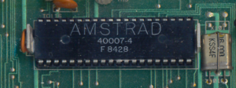
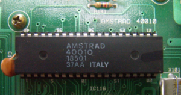
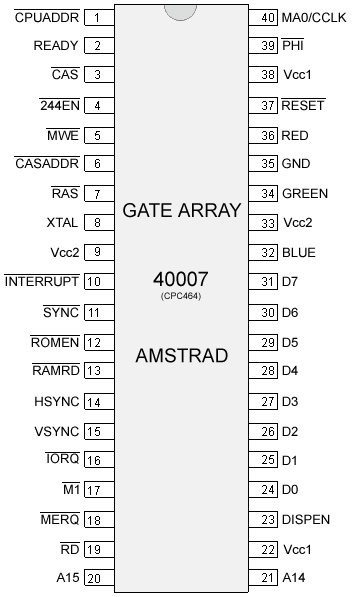

# Gate Array

**Обновлено 15 октября 2024 г.**

Также известен как Video Gate Array (VGA — не путать с видеокартами IBM PC).

**Оригинал статьи:** [https://www.cpcwiki.eu/index.php/Gate_Array](https://www.cpcwiki.eu/index.php/Gate_Array)

**Благодарности автору:** Выражаю благодарность сообществу CPCWiki за создание и поддержание этой энциклопедии, а также всем, кто исследовал и документировал работу Gate Array.

## Введение

Gate Array — это специально разработанная микросхема, созданная исключительно для использования в Amstrad CPC компанией Amstrad plc.

В системе CPC+ функции Gate Array интегрированы в единый чип ASIC. Когда ASIC «заблокирован», дополнительные возможности недоступны, и ASIC работает так же, как Gate Array в классическом CPC, что позволяет программам, написанным для CPC, работать на Plus без изменений. Чтобы получить доступ к новым функциям, ASIC необходимо «разблокировать».

В системе KC Compact функции Gate Array «эмулируются» TTL-микросхемами, CIO и EPROM трансляции цветов.

В «cost-down» версии CPC6128 функции Gate Array интегрированы в ASIC.

## Что он делает?

Gate Array отвечает за отображение (цветовая палитра, разрешение, горизонтальная и вертикальная синхронизация), арбитраж шины, регенерацию DRAM, генерацию прерываний и организацию памяти.

Проще говоря: **это «сердце» видеосистемы CPC**. Без него экран не покажет ничего.

## Арбитраж шины

Gate Array регулирует доступ к RAM между процессором (Z80) и видеооборудованием (CRTC и сам Gate Array).

Каждую микросекунду:

- CRTC генерирует адрес памяти, используя выходы сигналов MA и RA. См. страницу CRTC в вики, чтобы узнать, как проводка на материнской плате преобразует эти сигналы в адрес видеопамяти (VMA).
- Gate Array извлекает 2 байта для каждого адреса. `/CPU_ADDR` — это сигнал частотой 1 МГц. Таким образом, эти 2 байта извлекаются последовательно. Они не чередуются с доступом Z80. Эти байты извлекаются даже когда граница (border) включена, так как это необходимо для регенерации DRAM.
- Видеооборудование имеет приоритет, чтобы изображение не нарушалось.

Gate Array генерирует сигнал «READY», подключённый ко входу `/WAIT` процессора. Этот сигнал используется для остановки доступа CPU к RAM, пока видеооборудование обращается к ней.

Фактически, Gate Array позволяет Z80 обращаться к RAM только в 1 из каждых 4 циклов. В результате все тайминги инструкций растягиваются так, что становятся кратны микросекунде (1 µs), что даёт эффективную тактовую частоту CPU около 3,3 МГц .

В отличие от ZX Spectrum или Amiga, где арбитраж шины ограничен «contended memory» или «chip RAM», на CPC он также применяется к доступу к ROM и к расширениям RAM. Поэтому Z80 всегда работает на одной и той же скорости, независимо от типа памяти, к которой осуществляется доступ.

И последнее, но не менее важное: арбитраж шины также применяется к доступу к портам ввода-вывода. И доступ к памяти не выровнен с доступом к вводу-выводу на Z80.

**Примечание:** На Amstrad Plus ASIC также должен обрабатывать выборку инструкций DMA из RAM.

## Регенерация DRAM

На Amstrad CPC Gate Array отвечает за регенерацию DRAM вместо использования встроенного механизма регенерации DRAM в Z80. Причина в том, что в этой архитектуре может быть только 3 доступа к DRAM за микросекунду .

Z80 генерирует максимум один запрос за микросекунду. CPC также требует два доступа к памяти за микросекунду для чтения видеоданных.

Спецификация CPC предусматривает DRAM 4164-20. Для них требуется 330 нс для цикла чтения или записи. CPC также использует оптимизированные последовательные циклы CAS для чтения двух байтов видеоданных за половину микросекунды.

Способ вызвать сбой регенерации RAM как на Plus, так и на обычном CPC — просто остановить изменение нескольких битов адреса CRTC (то есть никогда не обновлять выбранную область).

Обычно нужно циклически менять только адрес строки, поэтому остановка изменения MA0–MA7 и остановка чтения этих строк процессором приведёт к быстрой потере данных (обычно примерно через 4 мс).

## Генерация прерываний

Прерывания на CPC создаются Gate Array на основе настроек CRTC. Gate Array имеет внутренний счётчик R52 (R означает Raster), который считает от 0 до 51, инкрементируясь после каждого сигнала HSYNC.

На всех CRTC прерывания R52 всегда начинаются через 1 мкс после окончания HSYNC. Но на CRTC 3/4 HSYNC происходят на 1 мкс позже, чем на CRTC 0/1/2. Это означает, что на CRTC 3/4 прерывания начинаются на 1 мкс позже, чем на CRTC 0/1/2.

R52 вернётся к 0, и Gate Array отправит запрос на прерывание при любом из следующих условий:

- Когда он превысит 51
- При установке бита 4 регистра RMR Gate Array в 1
- В конце 2-го HSYNC после начала VSYNC

Когда Gate Array отправляет запрос на прерывание:

- Если прерывания были разрешены на момент запроса, то бит 5 R52 очищается (но R52 всё равно был сброшен в 0), и прерывание происходит
- Если прерывания не разрешены, то счётчик R52 продолжает инкрементироваться, и прерывание остаётся взведённым (Gate Array при этом поддерживает свой сигнал INT). Когда прерывания разрешаются (инструкцией EI), бит 5 R52 очищается, и прерывание происходит. Это происходит только после инструкции, следующей за EI, так как эта инструкция Z80 имеет задержку в 1 инструкцию.

Проще говоря: **прерывания на CPC происходят примерно 300 раз в секунду** (каждые 52 строки развёртки). Это даёт программисту 6 «точек» на экране, где можно что-то изменить (цвет, режим) до того, как луч дойдёт до этой области .

**Примечание:** На Amstrad Plus система управления прерываниями серьёзно усилена. См. страницу ASIC в вики.

## Сигнал CSYNC

Сигналы HSYNC и VSYNC поступают от CRTC. Затем эти сигналы модифицируются Gate Array в C-HSYNC и C-VSYNC и объединяются в единый сигнал CSYNC, который отправляется на дисплей.

Когда CRTC HSYNC активен, Gate Array немедленно выводит цвет палитры чёрный. Если HSYNC установлен на 14 символов, то чёрный будет выводиться в течение 14 мкс.

Если ожидается смена графического режима, ширина импульса HSYNC должна быть не менее 2 мкс, чтобы Gate Array сменил графический режим.

C-HSYNC начинается через 2 мкс после активации CRTC HSYNC и длится максимум 4 мкс (сигнал обрезается, если ширина HSYNC больше 6).

Например, если CRTC R2=46, и ширина CRTC HSYNC составляет 14 символов, то C-HSYNC начинается с 48 и длится только до 51 включительно.

На Gate Array, даже если длительность CRTC VSYNC уменьшена до 2 мкс, Gate Array всегда будет выводить чёрный цвет в течение 26 строк с 4 строками C-VSYNC на монитор. В то время как на ASIC/Pre-ASIC CRTC VSYNC должен быть активен так долго, как сигнал C-VSYNC отправляется на монитор.

Gate Array (и ASIC/Pre-ASIC) использует 2...

*(Примечание переводчика: здесь оригинальная статья обрывается. Далее следует раздел «Управление Gate Array», который я привожу полностью ниже.)*

## Управление Gate Array

Gate Array управляется через ввод-вывод. Gate Array выбирается, когда бит 15 адреса порта ввода-вывода установлен в «0», а бит 14 адреса порта ввода-вывода установлен в «1». Значения других битов игнорируются. Однако, чтобы избежать конфликта с другими устройствами в системе, эти биты должны быть установлены в «1».

Рекомендуемый адрес порта ввода-вывода — `&7Fxx`.

Выполняемая функция выбирается путём записи данных в Gate Array: биты 7 и 6 данных определяют выбранную функцию (см. таблицу ниже). Чтение из Gate Array невозможно.

| Бит 7 | Бит 6 | Функция |
|-------|-------|---------|
| 0     | 0     | Выбор пера |
| 0     | 1     | Выбор цвета для выбранного пера |
| 1     | 0     | Выбор экранного режима, конфигурации ROM и управления прерываниями |
| 1     | 1     | Управление оперативной памятью |

**Примечание:** Эта функция недоступна в Gate Array, но выполняется устройством по тому же адресу порта ввода-вывода. В CPC464, CPC664 и KC compact эта функция выполняется в расширении памяти (например, Dk'Tronics 64K Ram Expansion); если это расширение отсутствует, функция недоступна. В CPC6128 эта функция выполняется PAL, расположенным на основной печатной плате, или расширением памяти. В 464+ и 6128+ эта функция выполняется ASIC или расширением памяти. Пожалуйста, прочитайте документ об управлении RAM для получения дополнительной информации.

### Выбор пера

Когда биты 7 и 6 установлены в «0», остальные биты определяют, у какого пера нужно изменить цвет. Когда бит 4 установлен в «0», биты с 3 по 0 определяют, какое перо выбрать. Когда бит 4 установлен в «1», значение, содержащееся в битах 3–0, игнорируется, и выбирается граница.

Перо остаётся выбранным до тех пор, пока не будет выбрано другое.

Каждый режим имеет фиксированное количество перьев. Режим 0 имеет 16 перьев, режим 1 — 4 пера, режим 2 — 2 пера.

**Сводка:**

| Бит | Значение | Функция                         |
|-----|----------|---------------------------------|
| 7   | 0        | Функция Gate Array «Выбор пера» |
| 6   | 0        |                                 |
| 5   | x        | не используется                 |
| 4   | 1        | Выбрать границу                 |
| 3   | x        | игнорируется                    |
| 2   | x        | игнорируется                    |
| 1   | x        | игнорируется                    |
| 0   | x        | игнорируется                    |
| 4   | 0        | Выбрать перо                    |
| 3   | x        | Номер пера                      |
| 2   | x        |                                 |
| 1   | x        |                                 |
| 0   | x        |                                 |

### Выбор цвета

После выбора пера можно изменить его цвет. Биты с 4 по 0 определяют номер аппаратного цвета из аппаратной цветовой палитры.

Хотя предусмотрено 32 цвета, возможны только 27. Остальные цвета являются дубликатами уже имеющихся в палитре.

| Бит | Значение | Функция                          |
|-----|----------|----------------------------------|
| 7   | 0        | Функция Gate Array «Выбор цвета» |
| 6   | 1        |                                  |
| 5   | x        | не используется                  |
| 4   | x        | Номер цвета                      |
| 3   | x        |                                  |
| 2   | x        |                                  |
| 1   | x        |                                  |
| 0   | x        |                                  |

#### Аппаратная цветовая палитра

Ниже приведена таблица цветов.

| Номер цвета | Название цвета               | R % | G % | B % | Изображение                                                  |
|-------------|------------------------------|-----|-----|-----|--------------------------------------------------------------|
| 0           | White                        | 50  | 50  | 50  |  |
| 1           | White (примечание 1)         | 50  | 50  | 50  |  |
| 2           | Sea Green                    | 0   | 100 | 50  |  |
| 3           | Pastel Yellow                | 50  | 50  | 0   |  |
| 4           | Blue                         | 0   | 0   | 50  |  |
| 5           | Purple                       | 100 | 0   | 50  |  |
| 6           | Cyan                         | 0   | 50  | 50  |  |
| 7           | Pink                         | 100 | 50  | 50  |  |
| 8           | Purple (примечание 1)        | 100 | 0   | 50  |  |
| 9           | Pastel Yellow (примечание 1) | 50  | 50  | 0   |  |
| 10          | Bright Yellow                | 100 | 100 | 0   |  |
| 11          | Bright White                 | 100 | 100 | 100 |  |
| 12          | Bright Red                   | 100 | 0   | 0   |  |
| 13          | Bright Magenta               | 100 | 0   | 100 |  |
| 14          | Orange                       | 100 | 50  | 0   |  |
| 15          | Pastel Magenta               | 100 | 50  | 100 |  |
| 16          | Blue (примечание 1)          | 0   | 0   | 50  |  |
| 17          | Sea Green (примечание 1)     | 0   | 100 | 50  |  |
| 18          | Bright Green                 | 0   | 100 | 0   |  |
| 19          | Bright Cyan                  | 0   | 100 | 100 |  |
| 20          | Black                        | 0   | 0   | 0   |  |
| 21          | Bright Blue                  | 0   | 0   | 100 |  |
| 22          | Green                        | 0   | 50  | 0   |  |
| 23          | Sky Blue                     | 0   | 50  | 100 |  |
| 24          | Magenta                      | 50  | 0   | 50  |  |
| 25          | Pastel Green                 | 50  | 100 | 0   |  |
| 26          | Lime                         | 50  | 100 | 0   |  |
| 27          | Pastel Cyan                  | 50  | 100 | 100 |  |
| 28          | Red                          | 50  | 0   | 0   |  |
| 29          | Mauve                        | 50  | 0   | 100 |  |
| 30          | Yellow                       | 50  | 50  | 0   |  |
| 31          | Pastel Blue                  | 50  | 50  | 100 |  |

**Примечания:** Это неофициальный цвет.

### Выбор экранного режима и конфигурации ROM

Это регистр общего назначения, отвечающий за экранный режим и конфигурацию ROM.

#### Выбор экранного режима

Функция битов 1 и 0 — определить экранный режим. Настройки битов 1 и 0 и соответствующий экранный режим приведены в таблице ниже.

| Бит 1 | Бит 0 | Экранный режим |
|-------|-------|----------------|
| 0 | 0 | Режим 0, разрешение 160x200, 16 цветов |
| 0 | 1 | Режим 1, разрешение 320x200, 4 цвета |
| 1 | 0 | Режим 2, разрешение 640x200, 2 цвета |
| 1 | 1 | Режим 3, разрешение 160x200, 4 цвета (примечание 1) |

**Примечание:** Этот режим неофициальный. Из возможных комбинаций видно, что можно определить 4 режима, хотя у Amstrad их только 3. Режим 3 похож на режим 0, потому что имеет такое же разрешение, но ограничен только 4 цветами.

Смена режима синхронизируется с HSYNC. Если режим изменён, он вступит в силу со следующего HSYNC.

#### Выбор конфигурации ROM

Бит 2 используется для включения или отключения области нижней ROM. Область нижней ROM занимает адреса памяти `&0000-&3fff` и используется для доступа к ROM операционной системы. Когда область нижней ROM включена, чтение из `&0000-&3FFF` вернёт данные из ROM. Когда значение записывается в `&0000-&3FFF`, оно будет записано в RAM под ROM. Когда она отключена, данные, читаемые из `&0000-&3FFF`, будут возвращать данные из RAM.

Аналогично, бит 3 управляет включением или отключением области верхней ROM. Область верхней ROM занимает адреса памяти `&C000-&FFFF` и представляет собой BASIC или любые ROM расширения, которые могут быть подключены к ROM-плате/блоку. См. документ о выборе верхней ROM для получения дополнительной информации. Когда область верхней ROM включена, чтение из `&c000-&ffff` вернёт данные из ROM. Когда данные записываются в `&c000-&FFFF`, они будут записаны в RAM по тому же адресу, что и ROM. Когда область верхней ROM отключена, данные, читаемые из `&c000-&ffff`, будут данными из RAM.

Бит 4 управляет генерацией прерываний. Его можно использовать для задержки прерываний. См. документ о генерации прерываний для получения дополнительной информации.

**Сводка:**

| Бит | Значение | Функция |
|-----|----------|---------|
| 7   | 1        | Функция Gate Array |
| 6   | 0        | |
| 5   | x        | не используется |
| 4   | x        | Управление генерацией прерываний |
| 3   | x        | 1=Отключить область верхней ROM, 0=Включить область верхней ROM |
| 2   | x        | 1=Отключить область нижней ROM, 0=Включить область нижней ROM |
| 1   | x        | Выбор экранного режима |
| 0   | x        | |

### Регистр 3 — Банкирование RAM

Этот регистр существует только в CPC с 128K RAM (например, CPC 6128, или CPC со стандартными расширениями памяти). **Примечание:** В CPC 6128 этот регистр представляет собой отдельную микросхему PAL, которая помогает чипу Gate Array. См. её страницу в вики.

| Бит | Значение | Функция |
|-----|----------|---------|
| 7   | 1        | Регистр MMR Gate Array |
| 6   | 1        | |
| 5   | x        | Номер 64K-банка (0..7); всегда 0 на нерасширенном CPC6128, 0-7 на стандартных расширениях памяти |
| 4   | x        | |
| 3   | x        | |
| 2   | x        | Конфигурация RAM (0..7) |
| 1   | x        | |
| 0   | x        | |

3-битное значение RAM Config используется для доступа ко вторым 64K из общих 128K RAM, встроенных в CPC 6128, или к дополнительным 64K-512K стандартных расширений памяти. Они содержат до восьми 64K-банков RAM, которые выбираются битами 3–5. Стандартный CPC 6128 содержит только банк 0. Обычно регистр установлен в 0, так что используются только первые 64K RAM (идентично моделям CPC 464 и 664). Регистр можно использовать для выбора только между следующими восемью предопределёнными конфигурациями:

| Адрес | 0 | 1 | 2 | 3 | 4 | 5 | 6 | 7 |
|-------|---|---|---|---|---|---|---|---|
| 0000-3FFF | RAM_0 | RAM_0 | RAM_4 | RAM_0 | RAM_0 | RAM_0 | RAM_0 | RAM_0 |
| 4000-7FFF | RAM_1 | RAM_1 | RAM_5 | RAM_3 | RAM_4 | RAM_5 | RAM_6 | RAM_7 |
| 8000-BFFF | RAM_2 | RAM_2 | RAM_6 | RAM_2 | RAM_2 | RAM_2 | RAM_2 | RAM_2 |
| C000-FFFF | RAM_3 | RAM_7 | RAM_7 | RAM_7 | RAM_3 | RAM_3 | RAM_3 | RAM_3 |

Видеопамять всегда расположена в первых 64K, VRAM никоим образом не затрагивается этим регистром.

## Программирование Gate Array — примеры

Определение цветов, установка пера 0 в ярко-белый:

```asm
LD BC,7F00    ; Порт Gate Array
LD A,%00000000+0  ; Номер пера (и функция Gate Array)
OUT (C),A     ; Отправить номер пера
LD A,%01000000+11 ; Цвет пера (и функция Gate Array)
OUT (C),A     ; Отправить
RET
```

Установка режима и конфигурации ROM:

```asm
LD A,%10000000+%00001110
OUT (C),A
RET
```

## Изображения чипов

<table>
<tr>
<td>


*Amstrad 40007 Gate Array*

</td>
<td>


*Amstrad 40010 Gate Array*

</td>
</tr>
</table>

## Изображения распиновки

<table>
<tr>
<td>



</td>
<td>


</td>
</tr>
</table>
