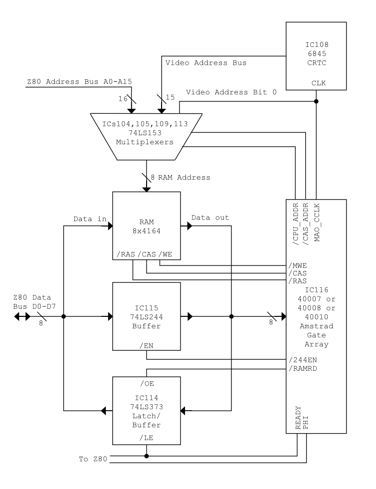
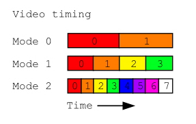
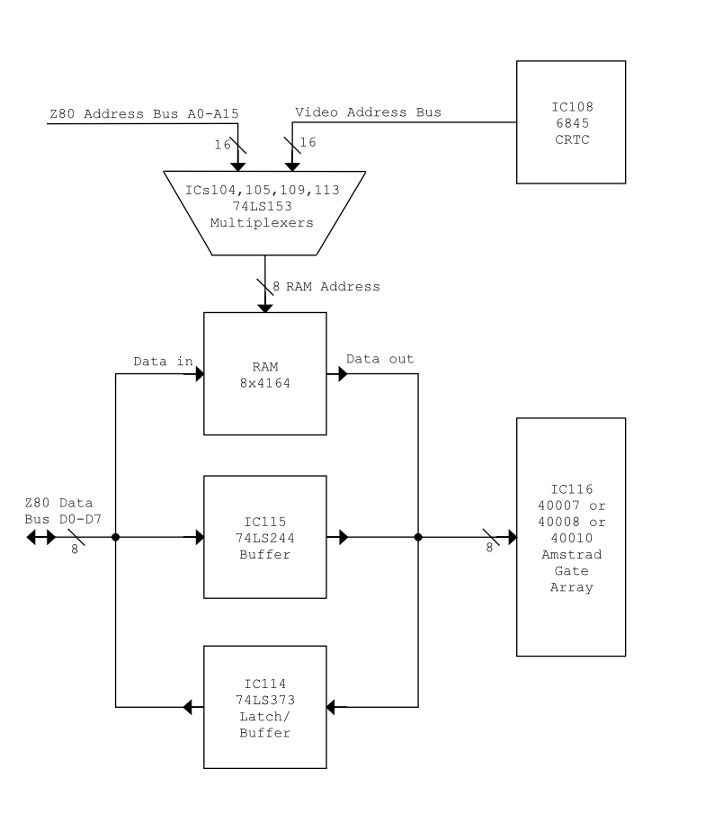
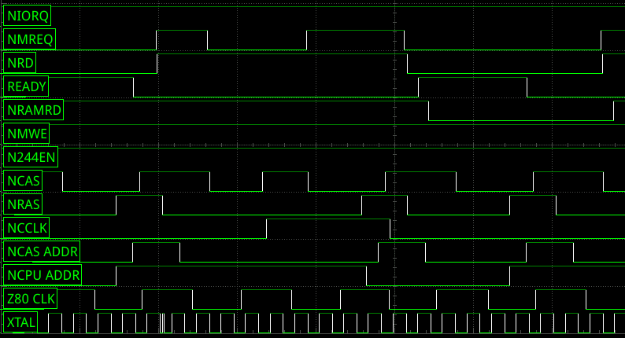
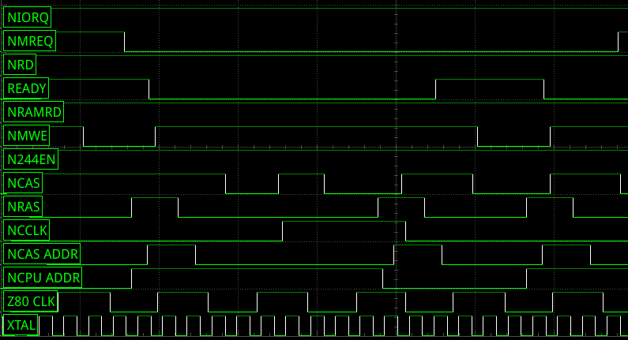
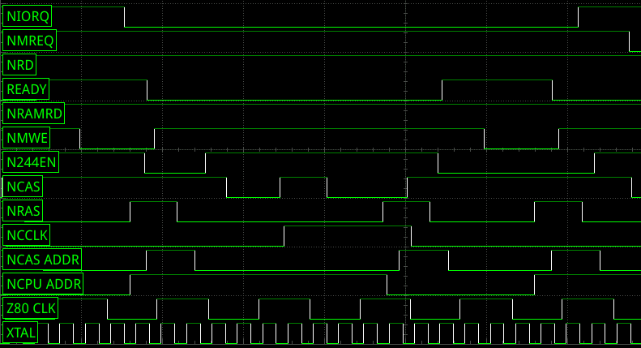
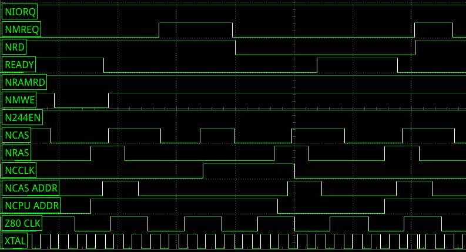

Вот максимально точный перевод статьи на русский язык с сохранением всех ссылок, изображений и сносок:

---

# Понимание видео, ОЗУ и подсистемы Gate Array в Amstrad CPC

[Amstrad CPC](https://en.wikipedia.org/wiki/Amstrad_CPC) — моя любимая[^1] 8-битная [домашняя компьютерная](https://en.wikipedia.org/wiki/Home_computer) система — у меня до сих пор сохранился мой детский CPC464. Есть много вещей, которые мне нравятся в его дизайне, включая [видеосистему](https://www.cpcwiki.eu/index.php/Video_modes), которая предлагает более высокое разрешение и большую цветовую палитру, чем у большинства его собратьев.[^2]

Недавно я приложил некоторые усилия, чтобы понять, как работает система CPC, и в частности видео- и RAM-схемотехника. В рамках проекта по эмуляции gate array с помощью [Raspberry Pi Pico/RP2040](https://www.raspberrypi.org/products/raspberry-pi-pico/) я особенно глубоко погрузился в эту область. Эта статья — моё текущее понимание того, как работает система.

Прежде чем продолжить, я хочу отдать должное небольшой группе людей, которые [вскрыли и провели обратную разработку](https://www.cpcwiki.eu/forum/amstrad-cpc-hardware/gate-array-decapped!/) реального gate array. Чтение их схем дало мне массу идей о том, как всё это соединяется вместе, и сэкономило мне много работы по обратной разработке.

## Обзор системы RAM-Video

Давайте начнём с рассмотрения того, что должна делать система RAM-video[^3].

[Процессор Z80](https://en.wikipedia.org/wiki/Zilog_Z80) использует ОЗУ системы для хранения данных, и часть этих данных — это видеоданные, которые отображаются на экране. CPC использует [контроллер 6845 CRTC](https://en.wikipedia.org/wiki/Motorola_6845) для помощи в преобразовании этих данных в видеосигнал, наряду с пользовательской схемой, содержащейся в [«gate array»](http://www.cpcwiki.eu/index.php/Gate_Array),[^4] или GA, чипе.

Это означает, что и Z80, и 6845/GA должны иметь доступ к ОЗУ.[^5] Разработчикам системы нужно было найти способ обеспечить совместное использование ОЗУ обеими системами без проблем. Например, как мы увидим, видеосистеме необходим доступ к ОЗУ на высокой скорости и с точными таймингами для генерации высококачественного изображения. А Z80 должен иметь возможность читать из ОЗУ и записывать в него в определённые моменты своих собственных операционных циклов.

*Рис. 1. Структурная схема системы RAM-video Amstrad CPC*

На рисунке 1 показана структурная схема системы RAM-video (см. также [схему](https://www.cpcwiki.eu/index.php/Schematics)). В верхней части — 16-битная шина адреса Z80 и 16-битная шина видеоадреса, идущая от CRTC. [Мультиплексор](https://www.electronics-tutorials.ws/combination/comb_2.html) переключается между этими двумя источниками для генерации адреса, который отправляется на чипы ОЗУ. Однако чипы ОЗУ на самом деле имеют только 8-битную шину адреса. 16-битные адреса нужно передавать двумя половинами (я опишу позже, почему именно так). Таким образом, мультиплексор фактически разделяет между верхней и нижней половинами шины адреса и верхней и нижней половинами шины видеоадреса. Это даёт четыре возможных выхода: видеоадрес высокий; видеоадрес низкий; шинный адрес высокий и шинный адрес низкий.

Если адрес, переданный в ОЗУ, является видеоадресом (от CRTC), то выход с чипов ОЗУ будет считан gate array (и превращён в видеосигнал). Если адрес от Z80, то это может быть либо чтение памяти, либо запись в память. Используемые чипы памяти имеют отдельные выводы для входных и выходных данных. Для записи в память данные будут считаны напрямую с шины данных Z80. Для чтения памяти они будут защёлкнуты в [74LS373](https://www.ti.com/lit/ds/symlink/sn54s373.pdf?ts=1621818770493) (IC114), где будут ожидать чтения Z80. Наконец, Z80 также должен иметь возможность отправлять конфигурационные данные (такие как текущие цвета экрана) в gate array. Это делается через буфер [74LS244](https://www.ti.com/lit/ds/sdls144d/sdls144d.pdf?ts=1621801134278&ref_url=https%253A%252F%252Fwww.google.com%252F) (IC115). Когда это устройство включено, сигналы с шины данных Z80 проходят через него и могут быть считаны gate array.[^6]

## Видеотайминги

CPC имеет три видеорежима:
Режим 0: 160ш x 200в @ 4 бита на пиксель (шестнадцать цветов)
Режим 1: 320ш x 200в @ 2 бита на пиксель (четыре цвета)
Режим 2: 640ш x 200в @ 1 бит на пиксель (два цвета)

Эти битовые глубины означают, что каждый байт видеопамяти кодирует два пикселя в режиме 0, 4 пикселя в режиме 1 и 8 пикселей в режиме 2.

*Рис. 2. Как пиксели кодируются в байт экранного ОЗУ. Числа — это индекс пикселя внутри байта, где 0-й пиксель отображается первым и является самым левым пикселем на экране.*

Если мы разделим ширину пикселей каждого режима на количество пикселей в байте, мы получим:
Режим 0 = 160 / 2 = 80 байт
Режим 1 = 320 / 4 = 80 байт
Режим 2 = 640 / 8 = 80 байт

Что интересно. Каждая строка экрана требует одинакового количества байт памяти. Наивная реализация gate array могла бы считывать байт данных для каждого отдельного пикселя. Но гораздо эффективнее считать байт один раз и извлечь данные для каждого отдельного пикселя из него. Таким образом, gate array всегда считывает байты с одинаковой частотой независимо от видеорежима.[^7] Затем он изменяет продолжительность отображения каждого пикселя на экране. Так, в режиме 1 он отображает каждый пиксель в два раза дольше, чем в режиме 2, а в режиме 0 — в четыре раза дольше.

*Рис. 3. Последовательность и продолжительность отображения каждого пикселя в каждом видеорежиме. Это также соответствует ширине каждого пикселя на экране.*

Видеосистема выдаёт сигнал 50 Гц, подходящий для телевизионных систем [PAL](https://en.wikipedia.org/wiki/PAL) или [SECAM](https://en.wikipedia.org/wiki/SECAM).[^8] Я не буду проводить полные расчёты, но при 640 экранных пикселях[^9] на строку, плюс области рамки и «интервалы гашения» между строками и экранами, gate array должен выдавать новый экранный пиксель каждую 16-миллионную долю секунды. Или, другими словами, он имеет «пиксельную частоту» 16 МГц.[^10]

А поскольку каждый байт видеоданных кодирует восемь экранных пикселей (с учётом видеорежима и растяжения, описанного выше), мы можем разделить эти 16 МГц на восемь, чтобы получить скорость, с которой данные должны считываться из памяти: 2 МГц. Выражаясь иначе, gate array должен считывать новый байт видеоданных каждые 2-миллионные доли секунды.

Учитывая, что gate array считывает данные на частоте 2 МГц, а процессор работает на частоте 4 МГц, мы видим, что существует очень реальная необходимость управлять доступом к ОЗУ, чтобы избежать конфликтов.

## ОЗУ, RAS и CAS

Есть ещё одна вещь, которую нужно понять, прежде чем мы углубимся в полные детали управляющих сигналов: ранние [чипы ОЗУ, такие как используемые в CPC](https://www.silicon-ark.co.uk/datasheets/TMS4164-datasheet-texas-instruments.pdf) и других компьютерах той эпохи, имели только восемь адресных линий.[^11] Amstrad использовал [микросхемы 4164](https://www.silicon-ark.co.uk/datasheets/TMS4164-datasheet-texas-instruments.pdf). Это чипы 64k x1. То есть каждый чип хранит 65536 *бит* данных с 1-битной шиной данных.[^12]

65536 соответствует 16-битному адресу. Чипы того времени использовали так называемое «мультиплексирование» адресных линий: они защёлкивали 8 бит, затем считывали другие 8 бит, а затем выводили бит данных по этому адресу (или записывали данные по этому адресу). Они называются адресами строк и адресами столбцов. Вы можете представить их как строки и столбцы дисплея: выберите строку для доступа, а затем выберите столбец внутри этой строки.[^13]

В аппаратном плане чипы имели входную линию /RAS и входную линию /CAS. Переведите линию /RAS в низкий уровень, чтобы защёлкнуть адрес строки, и линию /CAS в низкий уровень, чтобы прочитать или записать данные.

Чипы 4164 имеют ещё одну функцию, называемую «Page Mode» (страничный режим). Это позволяет быстрее получать доступ к данным в пределах одной строки. Опять же, вы подаёте сигнал /RAS, чтобы защёлкнуть адрес строки, а затем подаёте /CAS, чтобы прочитать или записать бит. Затем вы можете снять /CAS, изменить адресные линии и снова подать /CAS, чтобы получить доступ к другому биту данных без необходимости повторно защёлкивать адрес строки. Это удобный способ сэкономить время при доступе к нескольким битам данных в одной строке, и мы позже увидим, как это используется в CPC.

## Сигналы Gate Array

*Рис. 4. Структурная схема системы RAM-Video CPC с управляющими сигналами, выходящими из gate array.*

Теперь мы знаем достаточно о системе, чтобы начать описывать управляющие сигналы. Рисунок 4 выше показывает то же, что и рис. 1, но с добавлением соответствующих управляющих сигналов, выходящих из gate array. Для gate array я показал только входы и выходы, которые относятся к системе RAM-video.

Начиная с мультиплексора в верхней части. /CPU_ADDR и /CAS_ADDR выбирают, какое из четырёх подмножеств адресов будет выведено в ОЗУ. Если /CPU_ADDR низкий, то будут выведены данные с шины Z80, иначе — сигналы от CRTC. /CAS_ADDR переключается между строкой (верхние 8 бит адреса) и столбцом (нижние 8 бит адреса), как подходит для входов /RAS и /CAS в ОЗУ.[^14]

На практике пятнадцать из линий видеоадреса идут от CRTC. /CCLK обеспечивает шестнадцатую адресную линию — младший значащий бит. Работая как нулевой бит видеоадреса, эта линия выбирает между двумя соседними адресами ОЗУ. Помните «страничный режим» чипов ОЗУ? Gate array сбрасывает этот бит и отправляет данные /RAS и /CAS в ОЗУ для чтения байта. Затем он устанавливает этот бит и отправляет ещё один импульс /CAS в ОЗУ для чтения следующего экранного байта. Мне не совсем ясно, почему они решили сделать это, а не отправлять бит от CRTC и тактировать CRTC быстрее. Возможно, CRTC не может быть тактирован достаточно быстро.[^15] Возможно, это сделало gate array проще. Определённо, это гарантировало, что оба байта будут на одном адресе строки, и позволило использовать страничный режим ОЗУ для сокращения времени доступа.

/CCLK также обеспечивает тактовый сигнал 1 МГц для управления CRTC.

ОЗУ имеет входы /RAS и /CAS, как описано выше. Сигнал /MWE переводит вывод /WE (разрешение записи) в низкий уровень, когда Z80 записывает данные в ОЗУ.

Сигнал /244EN активирует 74LS244, чтобы gate array мог читать шину данных Z80.

Когда процессор хочет прочитать из ОЗУ, данные считываются через 74LS373 (IC114). Когда вывод /LE переходит в низкий уровень, чип защёлкивает данные на своих входных выводах. Эти данные выводятся, когда вывод /OE низкий. Если /OE низкий, а /LE высокий, то данные проходят напрямую. Amstrad использует сигнал READY от gate array для управления функцией /LE и сигнал /RAMRD для управления выводом /OE. Таким образом, данные защёлкиваются, когда сигнал READY переходит в низкий уровень. Сигнал /RAMRD может возникать в любое время и просто зависит от сигналов /RD и /MREQ Z80, того, какие ПЗУ в данный момент включены, и фактического адреса.[^16] Поскольку его тайминг не зависит от GA и других сигналов, я не буду описывать его здесь далее.

Система также отправляет сигналы PHI и READY в Z80 и шину расширения. PHI — это тактовый сигнал 4 МГц для управления процессором. READY подключён к сигналу /WAIT процессора, и я опишу его более подробно позже.

Есть ряд входов gate array, которые имеют значение (не показаны на диаграмме для ясности). XTAL — это тактовый сигнал 16 МГц от схемы кварцевого генератора. Остальные сигналы идут от Z80. /MREQ активен, когда он хочет получить доступ к памяти (чтение или запись). /IORQ активен, когда он хочет получить доступ к вводу-выводу. /RD активен, когда он хочет читать либо из памяти, либо из ввода-вывода.[^17] (И по импликации, если /MREQ или /IORQ активен, а /RD не активен, то процессор записывает в память или ввод-вывод. Этот факт используется gate array, чтобы избежать необходимости в дополнительном выводе для сигнала /WR Z80).

## READY и вход /WAIT Z80

На этом этапе мы можем наконец обратить наше внимание на метод, используемый gate array, чтобы гарантировать, что процессор и видеосистема не обращаются к памяти одновременно. Разработчики CPC сделали это, периодически «приостанавливая» Z80.

Старая память была не особенно быстрой. А иногда устройства ввода-вывода могут быть слишком медленными для процессора, работающего на многомегагерцовых скоростях, поэтому Z80 имеет встроенный механизм «паузы» — вход /WAIT. Если /WAIT подаётся в нужный момент, Z80 буквально просто останавливает всё, что делает, на один такт (или до тех пор, пока сигнал /WAIT не будет снят). Я не буду описывать механизм подробно здесь, но вы можете увидеть, как это влияет на тайминги [здесь](http://home.mit.bme.hu/~benes/oktatas/dig-jegyz_052/Z80-kivonat.pdf).

Каждая операция Z80 занимает несколько тактов. Он делит каждую операцию на один или несколько блоков, которые называются «M-состояниями». Каждое M-состояние включает одну операцию ввода или вывода или чтения или записи памяти,[^18] и каждое длится либо три, либо четыре такта. CPC генерирует сигнал /WAIT таким образом, что трёхтактовые M-состояния растягиваются до четырёх тактов, в то время как четырёхтактовые не затрагиваются. Для этого GA генерирует сигнал READY, который подключён к входу /WAIT Z80.[^19]

## Временные диаграммы

Теперь давайте посмотрим на некоторые осциллограммы, которые показывают, как всё это работает на практике. Осциллограммы показывают кристалл 16 МГц (XTAL)[^20] и 4 МГц PHI.[^21] Тактовые сигналы CPU внизу. Над ними — сигналы /CPU_ADDR, /CAS_ADDR и /CCLK, управляющие мультиплексорами. Затем сигналы /RAS и /CAS к ОЗУ. Над ними — сигналы /244EN, /MWE, /RAMRD и READY, которые управляют чипами вокруг gate array. Наконец, в верхней части — сигналы, поступающие в gate array от Z80: /RD, /MREQ и /IORQ.

*Рис. 5. Временная последовательность при чтении из ОЗУ (/MREQ и /RD низкие, как и /RAMRD)*

Рисунок 5 показывает осциллограмму типичной операционной последовательности — в данном случае для чтения процессором из ОЗУ. Gate array работает по последовательности, которая занимает 16 циклов тактового сигнала XTAL 16 МГц.

Последовательность начинается в момент, когда /CPU_ADDR переходит в высокий уровень, а /CAS_ADDR также переходит в высокий уровень вскоре после этого. Когда оба сигнала высокие, в ОЗУ подаётся адрес строки видео. /RAS изначально высокий и опускается в низкий уровень, чтобы сообщить ОЗУ о необходимости защёлкнуть этот адрес строки. /CAS_ADDR переходит в низкий уровень вскоре после этого, и в ОЗУ подаётся адрес столбца. Обратите внимание, что /CCLK низкий, поэтому нулевой бит видеоадреса низкий, и в ОЗУ подаётся адрес первого из двух видео байтов для чтения. Затем /CAS опускается в низкий уровень, и в течение следующего такта или около того ОЗУ будет выводить видеоданные, а gate array будет их защёлкивать.[^22]

Теперь gate array готовится ко второму байту видеоданных. /CCLK переходит в высокий уровень, как и /CAS, в готовности использовать функцию страничного режима ОЗУ. /CAS снова переходит в низкий уровень, и второй байт выводится ОЗУ и защёлкивается gate array.

В этот момент процессор теперь свободен для доступа к памяти, и /CPU_ADDR переходит в низкий уровень, так что в память будет подан адрес с шины адреса Z80. На самом деле сейчас могут произойти четыре вещи:
1) Процессор может записать в ОЗУ.
2) Процессор может прочитать из ОЗУ.
3) Процессор может читать или записывать в устройство ввода-вывода, включая gate array.
4) Ничего из вышеперечисленного. (Это может произойти, если Z80 не выполняет доступ к вводу-выводу или памяти в этом цикле, или если какое-то внешнее оборудование приостановило процессор).

Если процессор читает из ОЗУ (как показано на осциллограмме выше), то мы увидим повтор последовательности /RAS высокий => /CAS_ADDR (и /CAS) высокий => /RAS низкий => /CAS_ADDR низкий => /CAS низкий, чтобы заставить ОЗУ вывести запрошенные данные. К моменту, когда /CAS переходит в низкий уровень, /RAMRD будет низким, а READY будет высоким, и данные, выводимые из ОЗУ, будут переданы на шину данных Z80. Когда READY переходит в низкий уровень, данные будут защёлкнуты в ‘373, чтобы gate array мог перейти к следующему циклу. /RAMRD останется низким некоторое время (пока Z80 не отменит сигналы /RD и /MREQ), так что у Z80 есть время прочитать данные.[^23]

*Рис. 6. Тайминг при записи в ОЗУ (/MREQ низкий и /RD высокий, /MWE переходит в низкий уровень)*

Последовательность для записи в ОЗУ очень похожа, но в этом случае /RAMRD остаётся высоким, а /MWE перейдёт в низкий уровень, так что ОЗУ защёлкнет данные по заданному адресу (помните, что входные выводы данных ОЗУ подключены напрямую к шине Z80). Обратите внимание, что сигнал /MREQ низкий гораздо дольше, чем показано на цикле записи в память выше. Это может быть потому, что Z80 использует более короткое время чтения для цикла M1 (по сути, при чтении кода операции), чем для других чтений памяти. Более длительное чтение также может быть потому, что цикл растягивается сигналом /WAIT (READY).

*Рис. 7. Тайминг при записи ввода-вывода (/IORQ низкий и /RD высокий, /244EN переходит в низкий уровень, даже если запись не в gate array)*

Для записи ввода-вывода мы всё ещё увидим, что второй цикл /CAS не происходит. Вместо этого сигнал /244EN переходит в низкий уровень, и ‘244 выводит данные с шины адреса Z80, которые могут быть считаны gate array. Интересно, что осциллограмма показывает, что второй импульс /RAS происходит, как и импульс /MWE. Это, предположительно, для упрощения логики gate array, и это не влияет на ОЗУ, которое не выводит и не записывает, если сигнал /CAS не активируется.

*Рис. 8. Тайминг при чтении ввода-вывода (оба /IORQ и /RD низкие. /244EN переходит в низкий уровень, но не оказывает эффекта)*

И, аналогично, при чтении ввода-вывода сигнал /244EN всё ещё активируется, потому что это упрощает логику и ни на что не влияет.

*Рис. 9. Тайминг при чтении ПЗУ (/MREQ и /RD переходят в низкий уровень, но /RAMRD остаётся высоким)*

Вот осциллограмма, которая показывает, что сигналы /RD и /MREQ Z80 активируются, но gate array не активирует сигнал /RAMRD. Это указывает на чтение из ПЗУ.[^24]

Если не происходит ни доступа к вводу-выводу, ни доступа к памяти, то, как и следовало ожидать, цикл CAS процессора не происходит, и /MWE и /244EN оба остаются высокими.

Возвращаясь к общей работе gate array, последний шаг — /CCLK возвращается в низкий уровень, готовый к следующему чтению видео. Поскольку /CCLK также является тактовым сигналом для CRTC, это также заставляет его перейти к следующему шагу в своих собственных операциях (обычно к следующему адресу памяти для чтения).

## Подведение итогов

Я думаю, ясно, что проектирование серийного домашнего компьютера — это очень техническая задача, требующая большого мастерства. Но только когда вы детально изучаете реальный дизайн, подобный этому, вы понимаете, сколько мастерства в это вложено. На первый взгляд gate array CPC кажется просто упорядочивающим видеоданные в пиксели на экране с парой побочных задач для хорошей меры.

Но он также должен выполнять сложные задачи управления доступом к ОЗУ и связанными компонентами системы. И это требует детального знания каждого involved чипа, от Z80 до «клеевой логики». И это включает детальное знание таймингов, требуемых для каждого устройства. Я бегло взглянул на некоторые из этих таймингов, и по всей временной последовательности остаётся очень мало запаса.

Я всегда благоговел перед людьми, которые могли проектировать такое, а рассматривая дизайн в деталях, я ещё больше поражаюсь гениальности компьютерных дизайнеров той эпохи.

## Сноски

[^1]: Будучи подростком, я почти выбрал [Elan Enterprise](https://en.wikipedia.org/wiki/Enterprise_(computer)) вместо Amstrad. Недавно купив Enterprise, эта машина вполне может стать моей новой любимой.

[^2]: Признаюсь, он появился поздно на сцене, что означало, что его дизайнеры имели возможность учиться на машинах, которые были до него, а также на новых разработках, таких как более дешёвые цены на ОЗУ.

[^3]: В дальнейшем я буду называть эту схемотехнику «системой RAM-video» для удобства.

[^4]: Официально это «video gate array», или VGA, чип. Но поскольку этот термин, вероятно, вызовет путаницу со стандартом дисплея VGA IBM PC, я буду использовать термины «gate array» или GA.

[^5]: Когда две подсистемы обе нуждаются в доступе к ресурсу, возможно, одновременно, это называется «конкуренцией за шину».

[^6]: В gate array нет функциональности для чтения данных обратно процессором, поэтому нет пути данных или таймингов, доступных для этого. Очевидно, это можно было бы сделать через ‘373, как при чтении из ОЗУ, если бы это было нужно.

[^7]: И это делает всю видеосистему намного проще, чем та, которая обрабатывает данные на нескольких частотах, но с недостатком отсутствия гибкости в доступных видеорежимах.

[^8]: Система также может быть настроена на сигнал 60 Гц, подходящий для систем NTSC, но я не уверен, производились ли какие-либо системы с этим по умолчанию. Если да, то они имели бы то же разрешение и пиксельную частоту, но другие размеры рамки, чтобы учесть различное количество строк и столбцов на изображении.

[^9]: Здесь я говорю об «экранных пикселях», а не о «логических пикселях» видеорежима.

[^10]: Если вы когда-либо замечали, что CPC имеет [кварцевый резонатор](https://en.wikipedia.org/wiki/Crystal_oscillator) на 16 МГц, хотя процессор тактируется только на 4 МГц, это причина.

[^11]: Я не знаю точной причины этого, но Intel была крупным игроком в области чипов ОЗУ в свои ранние дни, и у неё была своего рода одержимость использованием небольших корпусов чипов с меньшим количеством выводов. Действительно, одна из причин, почему первые микропроцессоры, дизайны Intel [4004](https://en.wikipedia.org/wiki/Intel_4004) и [8008](https://en.wikipedia.org/wiki/Intel_8008), были трудны для использования в системах, заключалась в том, что у них было очень мало выводов, и нужно было мультиплексировать выводы (использовать одни и те же выводы для нескольких функций).

[^12]: Несколько чипов использовались параллельно, например, восемь чипов, используемых в CPC464 из-за его 8-битной шины данных. (CPC6128 использовал 16 чипов, но они были разделены на два банка по восемь, причём одновременно использовался только один банк).

[^13]: Мультиплексирование шины адреса таким образом также сделало доступ к памяти значительно медленнее. Хотя в то время это, вероятно, не было серьёзной проблемой. Действительно, необходимость мультиплексирования в CPC не значительно снизила скорость системы ниже номинальных 4 МГц процессора.

[^14]: /CPU_ADDR также обеспечивает тактовый сигнал 1 МГц для [генератора звука AY-3-8912](https://en.wikipedia.org/wiki/General_Instrument_AY-3-8910), не показанного на диаграмме.

[^15]: Со ссылкой на тайминги сигналов CPC (см. ниже), использование страничного режима ОЗУ означает, что второй байт доступен очень скоро после первого, что, вероятно, слишком быстро для максимальной тактовой частоты CRTC 3 МГц. И мультиплексоры также относительно медленные, что не помогло бы доставить второй адрес к чипам ОЗУ вовремя.

[^16]: Он также может быть подавлен сигналом /RAMDIS от шины расширения, который не показан на диаграмме выше для ясности.

[^17]: Есть пограничный случай, когда это не так, но он не относится к работе gate array, которую мы здесь обсуждаем, поэтому я его проигнорирую.

[^18]: Хотя несколько M-состояний тратятся чисто на внутренние процессы и не имеют никакой внешней активности.

[^19]: Как интересный факт, ZX Spectrum также обычно разрешает конкуренцию за шину с помощью состояний ожидания, но иногда делает это путём приостановки тактового сигнала процессора. (См. книгу «[The ZX Spectrum ULA](http://www.zxdesign.info/book/)» Криса Смита для более подробной информации). BBC Micro (и, как я понимаю, Commodore 64) использует преимущество более медленной тактовой частоты 6502 для чтения видеопамяти в течение части тактового цикла, без необходимости замедлять процессор. Другие микрокомпьютеры той эпохи используют аналогичные механизмы.

[^20]: Осциллограммы показывают некоторые глитчи на этом сигнале. Я считаю, что это проблема выборки осциллографа, особенно потому, что это не влияет на поведение gate array.

[^21]: Gate array фактически генерирует этот сигнал инвертированным. Осциллограмма показывает сигнал, который доходит до Z80 (и шины расширения).

[^22]: Чипы ОЗУ 4164 требуют до 70 нс для вывода данных после перевода /CAS в низкий уровень. Для тактового сигнала 16 МГц каждый такт составляет 62,5 нс. Поэтому я ожидаю, что gate array будет выбирать данные на следующем такте.

[^23]: /RAMRD перейдёт в низкий уровень только если CPC читает из встроенного ОЗУ. Он не будет генерироваться GA, если адрес, с которого происходит чтение, находится в пределах включённого ПЗУ, и он будет подавлен аппаратным обеспечением, внешним по отношению к GA, если внешнее аппаратное устройство подаёт сигнал /RAMDIS.

[^24]: Чтение из внешнего расширения ОЗУ дало бы аналогичную осциллограмму, за исключением того, что GA сгенерировал бы сигнал /RAMRD, но он был бы «отменён» расширением, генерирующим сигнал /RAMDIS. Это делается вентилем, внешним по отношению к gate array.

---